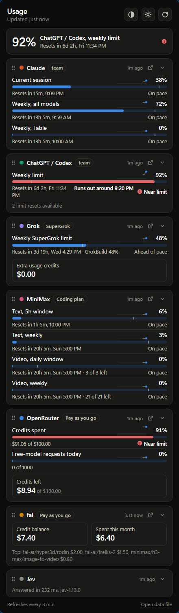
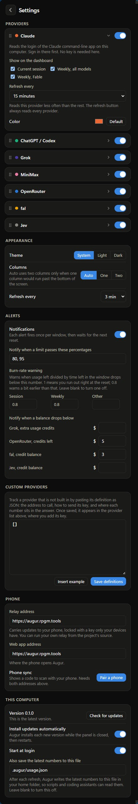
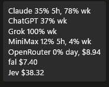
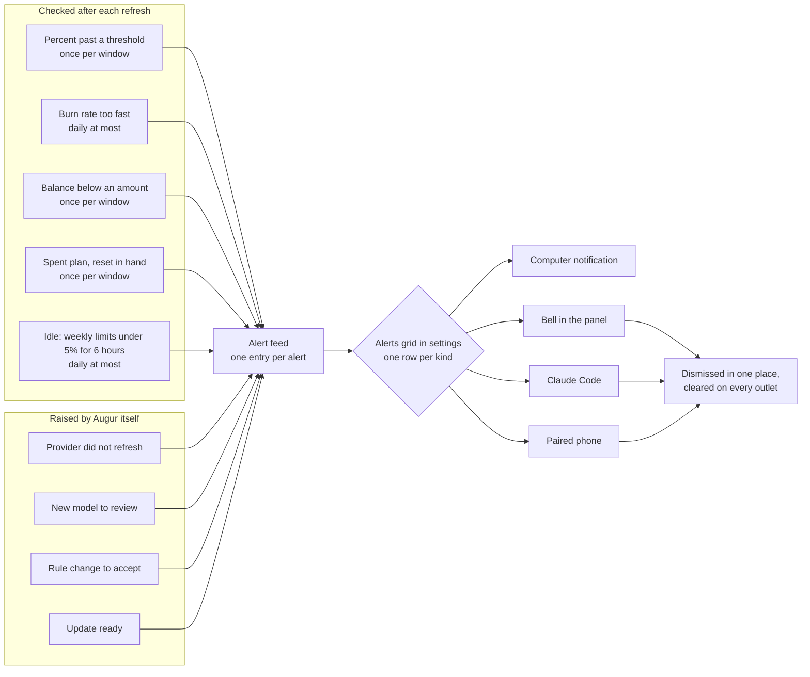
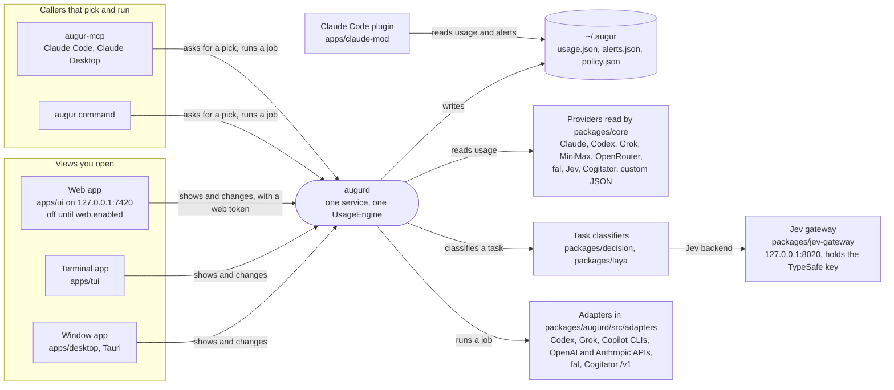
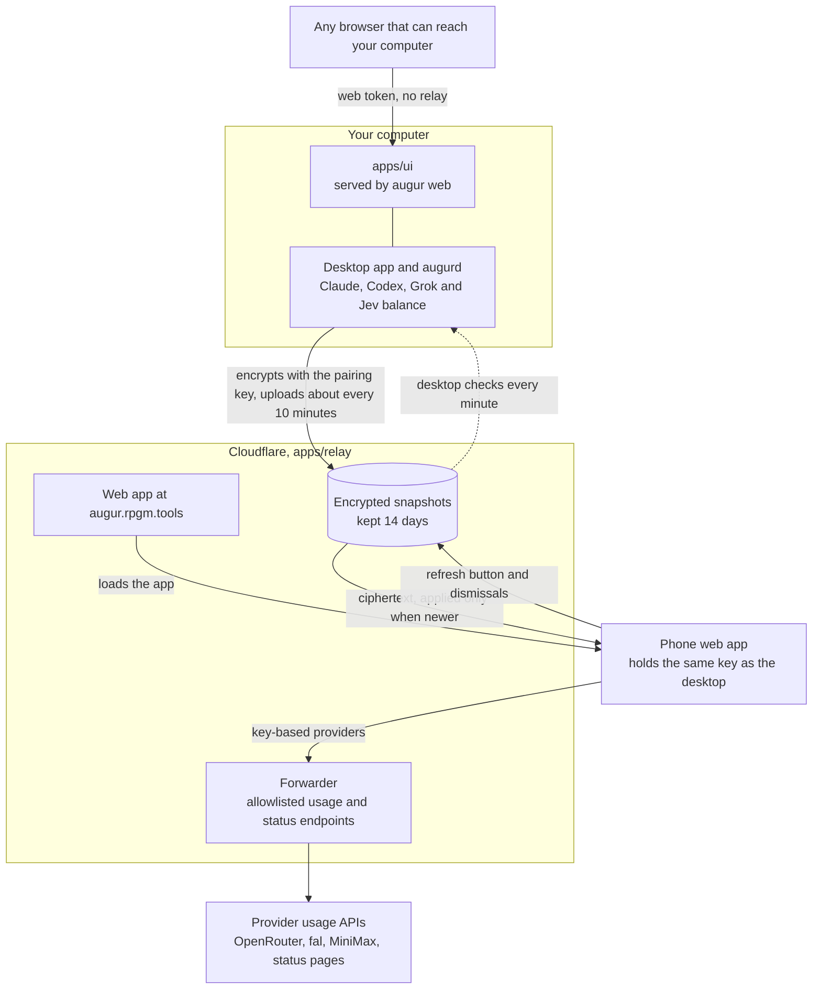

# Augur

Augur shows how much of your AI plans and credits you have used, in one place: a tray icon on Windows, a menu-bar icon on macOS, a full-screen app for the terminal, and a web app you can add to a phone's home screen. It reads the same numbers each provider's own usage page shows, refreshes each one on its own schedule, and warns you when a limit is running out faster than its window resets.

<table align="center">
  <tr>
    <td align="center" valign="top" width="50%">
      <br>
      <sub>The panel shows your most-used limit at the top and a card for each provider below it.</sub>
    </td>
    <td align="center" valign="top" width="50%">
      <br>
      <sub>In settings you choose what each card shows, how often it refreshes, and when Augur warns you.</sub>
    </td>
  </tr>
</table>

## What it tracks

| Provider | What you see | What it needs |
| --- | --- | --- |
| Claude | Current session, weekly limit, weekly limit per model, limit resets | The Claude Code app signed in on this computer with `claude` (a `claude setup-token` login cannot read usage), plus a one-time sign-in to claude.ai for the resets |
| Codex | Weekly plan limit, limit resets available | The Codex CLI signed in on this computer or Augur's own sign-in |
| Grok | Weekly SuperGrok limit | The Grok CLI signed in on this computer |
| MiniMax | Coding plan: 5-hour and weekly text limits, video counts | An API key |
| OpenRouter | Credits left, spend by the key today, this week and this month | An API key |
| fal | Credit balance, spend this month, top endpoints | An admin API key |
| Jev (TypeSafe) | Credit balance, spend and requests over the last 7 days, response time | An API key, plus a one-time sign-in to the TypeSafe console for the balance |
| Cogitator | Each of your machines, up or down, with its free memory and the models it holds; each role and the machine serving it | The gateway's address and a Cogitator key with the manage scope |

Claude, Codex, and Grok only report plan limits to a signed-in account, so Augur reads the login those apps keep on this computer and renews it the way the app does. For Codex, Augur can also hold a sign-in of its own (see [Signing in to Codex](#signing-in-to-codex)). An API key for Anthropic, OpenAI or xAI shows API billing, not plan limits, so it cannot stand in for the sign-in. The phone app shows them once you pair it with your desktop (see below).

You can add any other provider whose usage endpoint returns JSON, without writing code. See [Custom providers](#custom-providers). To run models on an API that uses the OpenAI or Anthropic format, choose Add provider on the Routes page or run `augur provider add`. Either one takes a base URL, a model and a key and sets up the route. [Adding a provider](docs/configuring.md#adding-a-provider) has the steps.

## Install

Every installer is on the [releases page](https://github.com/neostryder/augur/releases/latest). Augur is built and used mostly on Windows. The macOS and Linux apps come from the same code and the same release but get less testing. Running jobs for agents works on all three.

**Windows:** download the installer and run it. No administrator rights are needed. The installer is not code-signed yet, so Windows SmartScreen may warn the first time; choose More info, then Run anyway. The icon may land in the hidden-icons area at first. Drag it onto the taskbar to keep it in view.

**macOS:** download the `.dmg` (one build runs on both Apple silicon and Intel) and drag Augur into Applications. The app is not signed with an Apple developer certificate yet, so macOS blocks it the first time you open it. Open System Settings, go to Privacy & Security, choose Open Anyway next to the message about Augur, and confirm. After that it opens normally.

**Linux:** download the AppImage (runs on most distributions, including Arch, as long as WebKitGTK 4.1 is installed), or the `.deb` or `.rpm`. The tray icon needs an AppIndicator host: KDE Plasma has one built in, and GNOME needs the AppIndicator extension. On Linux the panel opens from the icon's menu rather than a click.

**Arch Linux:** each release carries two ready recipes with their checksums filled in: `PKGBUILD-augur-bin`, the window app built from the release's `.deb`, and `PKGBUILD-augur-terminal`, the terminal app and background service, which needs only Node.js 24 or newer. Download one into an empty folder and build it with makepkg, which also installs what it depends on:

```bash
curl -fLO https://github.com/neostryder/augur/releases/latest/download/PKGBUILD-augur-terminal
makepkg -si -p PKGBUILD-augur-terminal
systemctl --user enable --now augurd
```

The last line starts the service at each login; leave it out to start the service yourself with `augur service start`. The window app takes the `augur` name, so `augur-bin` puts the terminal command on your PATH as `augur-cli`, and it starts at login from its own settings. Install one of the two, not both. Either one tells you when a new version is out and leaves the update to pacman: download the new release's recipe and run the same makepkg line. The recipes are also in `packaging/arch` for building from a checkout.

**Terminal only:** a computer with no tray or taskbar can run the terminal app and the background service without the window app (see [In a terminal](#in-a-terminal)). On macOS, run the install script. It downloads the newest terminal build, checks the signature on the release's `SHA256SUMS.txt` and then the build against that list (this needs Node.js or minisign), and puts `augur` in `~/.local/bin`:

```bash
curl -fsSL https://github.com/neostryder/augur/releases/latest/download/install.sh | sh
```

The macOS build carries its own copy of Node, so nothing else has to be installed. Run `augur update` to move to a newer version; the previous one stays in place until the update after that.

Every release also carries `SHA256SUMS.txt`, with a checksum for each installer, `SHA256SUMS.txt.sig`, a signature of that list made with the same key the window app's updater trusts, and a bill of materials for the JavaScript and Rust dependencies. The install script and `augur update` refuse a list whose signature does not verify. The installers themselves are not signed, so compare a download against its line in that file before you run it: `Get-FileHash <file>` on Windows, `shasum -a 256 <file>` on macOS, `sha256sum <file>` on Linux.

Augur opens setup the first time it starts. Providers that are already signed in on the computer are turned on for you. For the others, paste an API key on the provider's card in Settings and turn it on. The Grok card needs the Grok CLI signed in on this computer, and the Claude card needs Claude Code signed in here, and the Codex card needs the Codex CLI signed in here or Augur's own sign-in. Without any of them, turn on a provider that takes an API key, such as OpenRouter. Keys are stored in the operating system's keychain (Windows Credential Manager, the macOS Keychain, or the Secret Service on Linux), and each one is sent only to its own provider.

Setup asks its questions in five steps, and it looks the same in the window app and the terminal app. First you pick what you pay for: Claude only, several subscriptions, API keys only, or a profile file saved on another computer. Then you confirm the providers Augur found, add any API service, and say how much of each subscription to hold back, which one to use first, and how much to spend on pay-per-use providers. On the review step you mark each model as strong or light and choose the models that write prose and give second opinions. A summary lists each setting your answers touch, and nothing is saved until you press Apply. A step you leave alone changes nothing. The last step tests each route that has a key and lists the models whose rules you still need to confirm. To change your answers later, choose Run setup again in Settings; it opens with your current settings filled in.

To see your TypeSafe balance, open Jev in settings and choose Sign in. Augur keeps that console session in its own window and uses it only to read your billing page.

To count your Claude limit resets, open Claude in settings, turn on Read resets from claude.ai and choose Sign in. Augur keeps that session in its own window and uses it only to read your usage page, about every six hours. Without the sign-in, enter the count under Limit resets in hand.

## Signing in to Codex

Augur can use the login the Codex CLI already has on this computer, or it can sign in to Codex itself. Signing Augur in is handy when the CLI isn't signed in here or the computer has no browser, like a home server that only meters. It also keeps Augur and the CLI from knocking each other out: a refresh token works only once, so when both renew the same login, whichever one renews second gets signed out.

Run `augur login codex`, open the link on any device within 15 minutes, and type in the short code. The command finishes as soon as you approve it. Your ChatGPT account has to allow sign-in with a device code, which is in its security settings, and on a workspace account only the workspace admin can turn that on. You can do the same thing from the Codex card in Settings, under Sign-in, in the window app or the [web app](#web-app-on-your-own-computer).

```bash
augur login codex     # prints a link and a code, then waits until you approve it
augur login status    # which login Augur reads for each provider: its own, the CLI's, or none
augur logout codex    # forgets Augur's own session and leaves the CLI's login alone
```

Augur keeps only the refresh token, in your operating system's key store (the Windows credential store, the macOS Keychain, or the Secret Service on Linux, or a file only you can read when none of those is available). Access tokens stay in memory. While Augur has its own session, it doesn't read or renew the CLI's login. Signing in or out takes the owner's token, so an agent working through the MCP server can't do either.

Claude has no sign-in of its own in Augur, so Augur always reads the Claude Code login on this computer. A computer can add one in a file named `local-signin.mjs` in the Augur folder (`~/.augur`, or the folder `AUGUR_HOME` names). The file exports `signInFlows`, an object that maps a provider id to a flow with `begin`, `complete`, and `renew` functions, and the comment at the top of `packages/core/src/signin.ts` describes what each one must do. No Augur download includes the file, and an update never replaces it. The service loads it when it starts and logs which providers it added, or why it could not load the file. The Sign-in block in Settings, `augur login`, and `augur login status` show only the providers that have a flow, and `--stdin` applies only to a flow that asks for a pasted code.

## Using it

Click the icon to open the panel. The ring on the icon shows your most-used limit, and its color turns amber at 75% and red at 90%. Hover over it for one line per provider without opening the panel. Ctrl+Super+U opens and closes the panel from any app (Super is the Windows key, or Command on a Mac), and settings can change or turn off that shortcut. The panel also opens by itself each time Augur starts; turn off Open the panel at launch in settings to keep it in the tray until you open it.

<p align="center">
  <br>
  <sub>Hovering over the tray icon shows every provider at a glance.</sub>
</p>

Each meter shows how much is used, when it resets, and a thin mark on the bar for where even pace would put you. Click a meter to see the last seven days, with dashed lines at each reset. Drag a card by its handle to change the order, and collapse cards you only check now and then. The panel switches to two columns when one column would not fit on the screen, or you can pick one or two columns in settings.

Augur checks for a new version every 5 minutes. When one is ready, an Update button appears next to refresh: hover over it to see what changed, or click it to install and restart. Augur also installs it on its own while the panel is closed, unless you turn that off in settings.

Settings also cover the theme (system, light or dark), which meters each card shows, card colors, how often each provider refreshes (from every 15 seconds to once a week), and alerts. Providers refresh every 15 minutes by default and Jev once a week, a provider whose last read failed tries again after 5 minutes, and the refresh button reads every provider at once.

## Alerts

Augur can notify you when:

- a limit passes a percentage you choose, such as 80% and 95%.
- a limit is burning too fast, meaning the usage left divided by the time left in its window drops below a ratio you set. Session and weekly limits each get their own ratio. At 1.0 you run out right at the reset, and 0.8 warns earlier.
- a credit balance drops below an amount you set.
- a plan is spent and a limit reset is in hand, for providers that report resets such as Codex, so you can use the reset to keep working.
- a provider that Augur spends in full sits idle, with its weekly limits all under 5% for at least 6 hours. Both numbers are settings.

A percentage, reset or balance alert fires once per window and waits for the next reset before it can fire again. A burn-rate alert repeats at most once a day while the limit keeps burning too fast. An idle alert does the same while the provider stays idle.

An alert stays under the bell at the top of the panel until you dismiss it or it stops applying, for example when the window resets. The grid under Alerts in settings picks where each kind of alert goes: your computer's notifications, the bell, Claude Code, and a paired phone. By default an update goes to the bell only, a failed refresh to the bell and Claude Code, a new model to review to the bell and your computer's notifications, and a rule change to accept to all four, unless you change that. A paired phone shows the same alerts under its own bell, and with Push notifications turned on in the phone app it gets them even while Augur is closed there. Dismissing an alert in one place clears it in the others.



Nine kinds of alert feed one list: five checks in `packages/core/src/alerts.ts` run after each refresh, and Augur raises four more on its own, such as a failed refresh or a new update. From `packages/core/src/feed.ts` each kind passes through its row in the Alerts grid to the computer notification, the bell, Claude Code, and the paired phone, though the outlets a kind starts with differ (an update goes only to the bell by default) and the grid can change them.

## Early resets

Some providers reset a usage window earlier than the time they report, and Codex weekly limits have done it repeatedly. Augur notices each reset as it refreshes and adds a line to `resets.jsonl` in the app's settings folder, beside `history.jsonl`, with the provider and meter, usage before and after, the reported reset times, how early the reset came, and the reset credits in hand. The file holds no keys or tokens, and Augur never trims it, so it can show a pattern over weeks.

`augur resets` needs the service running. It prints a summary for each provider and meter in your local time, then a table of recent events, and with fewer than 10 resets it says the sample is too small to show a pattern. `--provider` picks one provider, `--limit` sets how many events to list (200 by default, at most 1000), and `--json` prints the service's JSON. `/api/resets` on the web service and the `augur_resets` MCP tool return the same data.

```bash
augur resets --provider codex --limit 20
```

## Claude

Augur can show up inside Claude too. Settings has a Claude section with two switches.

Turn on Claude Code and your next Claude Code session shows Claude's 5-hour and weekly use in the status line, along with any other provider past 70%. After the two windows it shows Claude's pace as `hot +8`, `behind -12` or `on pace`, and leaves the pace out when Augur's numbers are stale. A new alert pops up once, then sits in a row above the prompt until you press D to dismiss it, which clears it in Augur and on your phone as well. Press O there to bring up Augur. This switch needs the usage file, so it turns that on at `.augur/usage.json` if you had it off. Augur updates the mod when it updates itself, and turning the switch off takes the mod back out. The same plugin gives Claude Code the Augur tools and the `/augur:setup`, `/augur:pick` and `/augur:balance` skills. You can also install it from Claude Code's own plugin manager, as [docs/claude-code.md](docs/claude-code.md) describes.

Claude Desktop chat lets your chats in Claude Desktop pick and run models through Augur. It is available on Windows and macOS, and on Linux where Claude Desktop's settings folder exists. Restart Claude Desktop after you flip it. Turning it off removes only what Augur added to Claude Desktop's settings.

## In a terminal

Run `augur` in a terminal and it opens a full-screen version of the panel. Tabs across the top hold Usage, Alerts, Rules, Dispatch, Balance, Local, Settings, and Setup. Press 1 to 8 or Tab to move between them, and ? for the keys on the page you are on. The first run opens on Setup. On that page, 1 to 5 and Tab move between its steps instead. The terminal app starts the Augur service if it is not running, and the window app and the terminal app are two views of that one service, so a change in either shows in the other. Providers, alerts, rules, routes, jobs, phone pairing, and the Claude Code and Claude Desktop switches are all there. The sign-ins that need a browser window, such as the Claude resets and the TypeSafe balance, still need the window app, and `augur login` signs Augur in to Codex from the terminal. Pairing draws its QR code in the terminal when the terminal is tall enough, and shows the link with a key to copy it when it is not.



Whether you open the window app, the terminal app, or the browser app, you are looking at the same augurd service, which starts in `packages/augurd/src/main.ts` and writes its state through `packages/augurd/src/home-files.ts`. The Claude Code plugin in `apps/claude-mod` is the odd one out: it never talks to the service and only reads the usage and alert files that augurd leaves behind.

The same command answers short questions that suit a status bar or a script:

```bash
augur status               # Claude's session and week, anything running hot, and the alert count
augur status --waybar      # the same as the JSON a Waybar custom module reads
augur refresh              # read every provider now
augur alerts               # list the alerts; add dismiss <id>, or --all, to clear them
augur resets               # recorded limit resets and their pattern; add --provider <id> or --json
augur claude install code  # or desktop; status and remove work too
```

`augur status --waybar` prints `text`, `tooltip` and `class`. The class is `ok`, `warn` or `crit`, and `off` when the service is not running; the command never starts the service. `augur service enable` starts the service at each login, through a systemd user unit on Linux or a launch agent on macOS, and `augur service disable` turns that off. Alerts sent to your computer's notifications use `notify-send` on Linux, so install `libnotify` if the command is missing, and the system notification center on macOS.

## Model rules

The rules page (the icon at the top of the panel) lists every model Augur has seen on your plans and lets you decide what agents may use each one for. Each model has a status, the activities it may do (write code, research, summarize and so on), the most sensitive data it may see (public, internal, sensitive or regulated), whether an agent has to be told to use it by name, whether it may write files or only text and patches, a cost step from free to very high, and how its provider handles prompts. A model can also be paused until a time you pick, either skipped or scored with replacement weights, and Dial back pauses every high-cost model until the next reset. A new provider starts with cautious defaults that its models inherit (public data only, text output, named before use), and every model starts unreviewed, so nothing can be used until you confirm it and allow its activities. Rules save to `policy.json` in `~/.augur`, and an agent or script reads that file. Each change goes into a history you can undo from, and a paired phone and desktop merge their edits, keeping the newer one for each field.

A model can also wait on others. Check models under Use only after and the model stays out of picks until every one of them is spent, paused, not allowed for the task, or down. The providers of the models it waits on are then used up in full instead of paced, so a Codex plan runs to its limit before Copilot's GPT-6 Sol is picked. A spent provider still counts while it has a limit reset in hand, so the models waiting on it stay held until the reset is used. A limit reset in hand, which Codex reports and Claude needs entered in its provider settings, counts as one more full weekly window of room for a provider that is paced, and a pick says when a spent provider still has a reset waiting.

## Running jobs for agents

Turn on Also run jobs in setup or on the Service page and Augur starts a service on your computer. An agent asks it which model to use with `augur pick`, then runs the task with `augur run`. The service checks your rules and how much of each plan is left before it starts anything, and a job that breaks a rule is refused with the reason. On Windows the `augur` command is `service\augur.cmd` inside the install folder (`%LOCALAPPDATA%\Augur`), which is not on your PATH. In the macOS app it is `Contents/Resources/service/augur` inside Augur.app, and a terminal install already has it on your PATH. In the Linux `.deb` it is `/usr/lib/Augur/service/augur`, and the Arch packages put it on your PATH as `augur` (`augur-terminal`) or `augur-cli` (`augur-bin`).

```bash
augur pick --activity write_code --data internal
augur run luna --activity write_code --data internal --prompt "Add tests for parse()" --wait
augur usage
```

Here `luna` is a route you added on the Routes page. To add one, choose Add route, name it, pick the model it runs and the adapter that runs it (Codex CLI, Grok CLI, GitHub Copilot CLI, an OpenAI-style or Anthropic-style API, or fal video, among others), and fill in the options the form marks as required. Test route sends one word through it, so a bad path or a missing key shows up before an agent depends on the route.

A run has to state its activity and data tier, and it has to follow a pick made for the same caller in the last hour. `--activity` takes one of `write_code`, `review_code`, `research`, `reason_critique`, `draft_prose`, `summarize_extract`, `long_context`, `bulk_tagging`, `typed_decisions`, `read_images`, `generate_images`, `generate_video`, `speech`, `embed`, `transcribe`, `translate` or `reverse_engineering`. `--data` takes `public`, `internal`, `sensitive` or `regulated`, and a model is only offered for data at or below the tier its rules allow. A caller is whatever asks: the `augur` command, an MCP client or a script. `augur --help` lists every command.

A few options change what a run sends. When the service has a [charter folder](docs/configuring.md#standing-instructions-for-every-job), every prompt starts with its standing instructions, `--pack <names>` adds packs from it, and `--no-charter` leaves it out. `--conversation <name>` opens a conversation on a Grok or Codex route, and later runs with the same name resume that session, so `augur run grok --conversation parser --prompt "Now check the error paths" ...` picks up where the last run on `parser` stopped. `augur conversations` lists them and `--forget <name>` drops one. With Retry on failure turned on in the service settings, a job that fails on a provider limit, a harness that will not start or a read-only timeout runs again on its route's [fallback](docs/accounting.md#budgets-and-fallback-routes), and `--no-failover` keeps it where it is.

- The Jobs page lists what agents started, with each job's result, output and errors, and lets you cancel one that is still going. Cancelling a job, or a job reaching its time limit, ends everything it started: through a job object on Windows, a systemd user scope on Linux where systemd runs, and otherwise the job's process group plus every process the service saw descend from the job. Without a job object or a scope the service looks for those processes about once a second, so one that starts and detaches between two looks can outlive a cancel.
- The Routes page joins a model to the program that runs it. A route is an entry in `dispatch/routes.json`, and Test route checks that it works. For a new API in the OpenAI or Anthropic format, Add provider adds the route, the model and the key in one form. An API route can keep its key in the operating system's key store: choose store as the key source and save the key on the page or with `augur key set <route>` (it asks for the key with the typing hidden, or reads a variable you set yourself with `--env <NAME>`, and names the host the key will be sent to), and it never appears in `routes.json` or a job record. The store is the Windows credential store, the macOS Keychain, or the Secret Service on Linux, with a file only you can read as the fallback where no Secret Service answers.
- The Service page holds the service's settings, and `augur config` shows the same list.
- Tokens and cost appear with each job, labelled reported, derived or imputed. [docs/accounting.md](docs/accounting.md) explains how they are worked out and how to set a rate.
- `augur-mcp`, beside `augur` (`augur-mcp.cmd` on Windows), lets Claude Code, Claude Desktop and other MCP clients pick and run models under the same rules, and add routes whose models wait for you to confirm them. See [docs/mcp.md](docs/mcp.md).

Uninstalling Augur stops the service and removes the program, and leaves your job history and your rules behind. The history is in `%LOCALAPPDATA%\Augur\dispatch` on Windows and `~/.local/share/augur/dispatch` on macOS and Linux, and the rules are in `~/.augur`. Delete those folders to remove everything.

### Local models

Cogitator is a gateway that serves models from your own machines, and Augur works with it in two ways: it reads the gateway like a provider, and it sends jobs to it through API routes. To read it, open the Cogitator card in Settings, set Gateway address (`http://127.0.0.1:8470` by default, or another machine on your network such as `http://eru:8470`), and save a Cogitator key with the manage scope as its Manage key, which goes in the key store. The routes use a separate key with the infer scope. Augur reads the gateway every 30 seconds, and when the gateway stops answering, the last reading stays on screen marked stale.

The dashboard card shows how many machines are up and one chip per role, such as `judge Eru`, `summarize Bilbo, degraded` when a later machine in the role's chain is serving it, `embed cold` when the model is installed but not loaded, and `transcribe down` when no machine can serve it. Open on the card goes to the Local page in the window app, which lists each machine with its memory and models, each role with its chain and the link serving it, and the recent jobs a gateway served. The terminal app has the same page on its Local tab, and the phone shows only the machine names and any degraded roles.

To send jobs to the gateway, choose Add provider on the Routes page, pick the OpenAI-style or Anthropic-style shape, and give it the gateway's `/v1` address, such as `http://eru:8470/v1`. A plain `http://` address works for this computer or a machine on your home network, and anywhere else still needs https. Set `requestClass` to `cogitator` so background jobs go at low priority and a job from someone typing at a terminal goes at normal priority. The other route options are `headersJson`, `maxInput`, `maxImageMb`, `maxAudioMb`, and on an OpenAI-style route `mode`, for embeddings or transcription; [the API adapter options](docs/configuring.md#openai-api-openai-style-api) describe each one.

A route is local when its model is listed under the cogitator provider in the rules, and a pick weighs it against the latest reading. A local route is blocked when its machine is down or no machine can serve its role, and every local route is blocked while the gateway cannot be reached. A model that is installed but not loaded scores 0.7 times as much, a route on a machine short of memory scores 0.8 times as much, and a route with both gets both. Hosted routes are unchanged, an old reading is ignored, and the pick's reason line says which of these applied.

`augur run --attach <file>` sends a file with the prompt on an API route, and the option can be repeated. A text file is added to the prompt and counts toward `maxInput`, an image goes to a model that reads images, and one audio file goes to the transcription endpoint on a `transcribe` job. A route in `embeddings` mode takes only `embed` jobs and saves the vectors to `vectors.json` in the job folder. `--urgent` marks a job as wanted now, so the gateway gives it normal priority. Each job a gateway serves records the machine, the model, the chain link and whether that link was a fallback, and the Jobs page, the terminal app's job view, and `augur jobs` show it as, for example, "Served by: bilbo, link 2, a fallback".

### Who classifies tasks

`augur pick --task "..."` can work out the activity and data tier from a description. The setup screen and the Service page ask who does that.

Augur's Jev classifier can also go through a [Jev gateway](docs/jev-gateway.md#using-it-for-augurs-own-classifier), which holds the TypeSafe key so Augur needs none of its own. Set `decision.gateway` to the gateway's address, with `augur config set` or on the Service page.

### How a pick balances models

A pick also leans toward models that suit how much the task weighs. Routine work, such as renames, plumbing, and boilerplate, leans hard toward the lighter models (Sonnet, Luna, DeepSeek, MiniMax). Reviews, research, summaries, and bulk work are everyday work and lean the same way more gently. Coding and hard reasoning are deep work and go to the strong models (Opus, Sol, Grok) first, and core work, such as an engine, core logic, or security-critical code, leans toward them hardest. That keeps the strong models' usage for the tasks that need them. Prose goes to Opus at any depth. Each route also gets a lift on the activities it is known for, such as MiniMax on long context and ChatGPT on research. Fable and Astra are never picked unless a caller names one. `--depth routine`, `everyday`, `deep`, or `core` sets the weight for one task. Without it, the decision backend judges the task description, and the activity's default applies when it cannot.

A route can be capped at a number of picks a day or per session, and a capped route sits out until a caller names it. Training mode, off by default, turns each pick on a strong model into a proposal that waits for you, and `augur pick-answer <pick id> --model <route>` records the route you chose. Once your answers for a kind of work agree with the proposals often enough, that kind of work stops asking, apart from core work and an occasional spot check. [docs/configuring.md](docs/configuring.md#task-weight-caps-and-training-mode) has the settings.

Every provider that reports a 5-hour or weekly usage window is paced against it. Each window is compared with how much of it has passed, and the stricter one wins. A provider more than its band ahead (5 points for Claude, 10 for the others) runs hot and leans toward its light models, such as Sonnet for Claude, and one more than its band behind leans toward its strong models. A window at the provider's reserve, 90% by default, moves its optional work to another provider while one can take it. Claude's work can then go to a backup route, and any other provider's work goes only to another subscription. A provider with no usage window is not paced, and a caller that names a model still gets it. The `pace` section of the `balance` rules holds each provider's band, reserve, leans and boost. A provider's figures count for two hours after each read, or for one and a half refresh intervals when it is read less often, so Jev's balance, read once a week, counts until the next read. Older figures are left out of the pace and of the room a model has left.

A paced provider with allowance left gets a boost on its routes' scores, up to 1.5 times at the start of a window. The boost shrinks as the provider's fullest window fills and fades out over the last 10% of that window. A provider that runs hot, sits at its reserve or reports no reset time gets no boost, and neither does a route the caller rated below 0.6 for the task. On prose drafting only the prose routes are boosted.

The pick is drawn by odds rather than always going to the top score. A route's odds are its score over the sum of the scores in the draw, and a route under a quarter of the top score is left out, so a Preferred model at 2.5 against a Normal one at 1.0 wins about 71% of the time. A named model always wins. `--best` takes the top score instead. `--snippet` marks a draft of one sentence or one bullet with no batch of prose to go with it, so it is not held to the Opus routes. The pick prints the model, a line saying why it won and which came next (or the odds it was drawn at and which route led), and each route's score, odds and routes. `augur pick-preview` takes the same arguments and prints the same ranking with `preview: no draw made`, and it records nothing. The service keeps the picked route's odds, whether it was drawn and the draw's seed with each pick, and the seed repeats the draw.

Copilot models, and DeepSeek when coding, are backups. They get a task only when no other route can take it, unless the model has its own wait rule. Copilot's Anthropic models are the exception once Claude reaches its reserve. Copilot's usage figures give its spend for the month. A pick mentions the spend once it passes $150 and drops Copilot at $250, except its Anthropic models while Claude is at its reserve. The `fallback` section of the `balance` rules changes these amounts.

A pick can name more than the top model. Most tasks get a second opinion from MiniMax when its data tier allows it, and small tasks such as tagging, typed decisions and speech do not. Research and image tasks name a free web route, ChatGPT or Gemini, together with the steps: create `~/.augur/web/<kind of work>-<date and time>/`, write the task to `brief.md` there, give that file to the route in the browser, and save what it returns as `result.md` beside it. The caller does that, because Augur does not drive a browser. Jev is first for typed decisions and tagging. The local model is named as a shadow beside a pick made by a reasoning model, so the two answers can be compared. The `seats` section of the `balance` rules changes any of these.

`augur balance` prints what the router is doing. Each paced provider that needs attention gets its own row, hot first, then those with missing figures, then those behind: its stance, how much of each window is used against how much has passed, the boost, and its rough odds of taking a coding task. Providers on pace share one group, and those with no usage window are named under Not paced. After that come Copilot's spend for the month, how each provider is treated, where each kind of work goes now, and what the last days of picks were, including each pick that went to Copilot with the month's spend at that moment. `--days` sets how many days of picks it covers. The service writes the same report to `~/.augur/balance` once a day, as a JSON file and a text file. The window app shows it on a Balance tab beside Jobs, Routes and Service, and the terminal app on a Balance page. The report only reads; nothing in it changes a rule.

The service keeps a decision log of picks and jobs. `augur label <pick or job id> --brief met|partly|missed [--note <text>]` adds how a job's report met its brief, which the caller's own tooling checks, and the service rewrites `~/.augur/balance/labels.jsonl` each hour with one line per pick: the model picked, the models its jobs ran on, whether any of them was not the pick, how each job ended and the brief result. The file holds no task text, so the local Laya model can learn from it without the tasks leaving the machine.

Pauses, ask-first, data tiers and your weights apply first. The `balance` section of the rules sets each activity's depth, each model's tier, what each route suits, the excluded names, how often each route may be picked, how strong each lean is, which models write prose, each provider's pace and boost, the draw, and training mode, and `"enabled": false` there switches it off. The rules live in the app's `config.json` and Augur writes them out to `policy.json`, so a hand edit to `policy.json` is lost the next time a rule is saved. [docs/configuring.md](docs/configuring.md) lists every setting, and [docs/adapting.md](docs/adapting.md) covers adding a provider or a new way to run a model.

- **None** is the default. The agent gives the activity and data tier itself.
- **Jev** is a hosted model from TypeSafe. The text of each task goes there with your API key, except text about students, which is checked on your computer first and never sent. Put the key in the `TYPESAFE_API_KEY` environment variable. Your other programs that call Jev can use the [Jev gateway](docs/jev-gateway.md) at `http://127.0.0.1:8020` instead, and it supplies the key for them.
- **Laya** is an open-weight model of the same kind that runs on your own computer, so task text never leaves your network. It needs Python 3.10 or newer, PowerShell 7 from the Microsoft Store, and about 6 GB of disk: 2.3 GB for the model and around 3 GB for PyTorch with GPU support. An NVIDIA GPU makes it faster and is not required. From a checkout of this repository, in PowerShell:

```powershell
$root = "$env:LOCALAPPDATA\Augur\laya"
New-Item -ItemType Directory -Force "$root\logs" | Out-Null
python -m venv "$root\venv"
& "$root\venv\Scripts\pip" install laya
$env:HF_HOME = "$root\hf"
& "$root\venv\Scripts\python" -c "from huggingface_hub import snapshot_download; snapshot_download('convaiinnovations/laya', revision='55cf4c4ebb4ebe31b2550e8bdf3bd21b99753851')"
python packages\laya\deploy.py
pwsh -NoProfile -File packages\laya\windows\install-task.ps1
```

The last line registers a logon task named Augur Laya that serves the model at `http://127.0.0.1:8010`. Then choose Laya on the Service page. The server takes the model out of video memory while a game runs, while other programs keep the card busy, and after 10 minutes with no request. It loads the model again when the next request arrives, or by itself once a busy card is free. A Laya that another tool starts from the same `serve_lora.py` on port 8010 behaves the same way, and Augur uses it with no extra setting. To use several machines, list each one, this computer included, as `{"name": "...", "url": "http://...:8010"}` under `decision.servers` in the service's `config.json`, which is in `%LOCALAPPDATA%\Augur\dispatch` on Windows. Augur tries them in order and skips one that is busy or down. Another tool, such as Cogitator, can also serve Laya at `http://127.0.0.1:8010`, and Augur uses it there with no change to the Laya setting.

### Grading and the Jev gateway

`augur grade bug-report --task @task.txt --candidate @report.md` scores the candidate against `~/.augur/rubrics/bug-report.json` and prints a score for each dimension. Grades stay in shadow mode until `augur label` has recorded enough agreement for the rubric's stakes. [docs/grading.md](docs/grading.md) has the rubric fields and the thresholds.

The Jev gateway is a System One server on `127.0.0.1:8020` that holds the TypeSafe key for other programs and keeps `sensitive` and `regulated` requests on Laya. [docs/jev-gateway.md](docs/jev-gateway.md) explains how to build and configure it, and how a client falls back when it is down.

### Prose requests

Agents and scripts can queue writing requests instead of running each one on its own, and the service sends them to one prose route in batches. `augur prose add` adds a request, from a JSON file or from flags:

```bash
augur prose add --file request.json
augur prose add --requester docs --repo augur --target docs/mcp.md --kind write --surface doc --audience "MCP client authors" --voice plain --fact "augur_prose_list lists requests" --fact "MCP clients cannot run a batch" --data public
augur prose list --status drafted
augur prose status
augur prose run --dry-run
augur prose approve <id>
```

A request names who asked it (`--requester`), a repo label, the file it is for or `new`, its kind (`write`, `rewrite`, `review`, or `sweep-edit`), its surface (`README`, `changelog`, `ui-strings`, `post`, `doc`, or `other`), the audience, and the voice. `--fact`, `--must-include`, and `--must-avoid` can each be given more than once, and a fact added with `--fact` is recorded with `CLI request` as its source. `--context-file` adds a file's text as the context before the passage. A rewrite or a review needs the text it works on in `--current-text`. `--urgency` is `normal` or `urgent`, and `--data` sets the data tier, `internal` when left out. A JSON file takes the same fields by their JSON names (`mustInclude`, `currentText`, `dataTier`, and so on), plus `limits` with `length` and `format`, facts that carry their own `source`, and `context` with `before`, `after`, `outline`, `samples`, and `glossary`.

`augur prose list` prints each request's id, status, repo, and target, `--status` keeps one status (`queued`, `awaiting-approval`, `running`, `drafted`, or `failed`), and `--json` prints the whole requests with their drafts. `augur prose status` counts the requests in each status, gives the age of the oldest normal request in the queue, and says whether a batch is due. A batch is due once 10 normal requests are queued or the oldest has waited 24 hours, and [docs/configuring.md](docs/configuring.md#prose-requests) has the settings that change both. `augur prose run` submits the batch in the background and prints its batch ID, then `status` and `list` show how it is going. `--dry-run` says how many requests would run and starts nothing.

An urgent request waits in `awaiting-approval` until you run `augur prose approve <id>`, and approved urgent requests then go out together at the next run, apart from the normal batch and whether or not it is due. `run` and `approve` are owner commands: the agent token cannot call them, and the MCP server has no tools for them. MCP clients add, list and check requests with `augur_prose_add`, `augur_prose_list`, and `augur_prose_status`.

## Phone app

The web app works in any modern mobile browser. Open [augur.rpgm.tools](https://augur.rpgm.tools) on the phone and add it to your home screen: on iPhone, tap Share in Safari (on newer iPhones it is in the menu at the bottom) and then Add to Home Screen; on Android, use the install prompt. On its own it can track the providers that use API keys: the keys are encrypted on the phone and requests go through a relay that forwards them without storing anything.

To use it with your desktop, choose Pair a phone in the desktop app's settings. Then open Augur on the phone. A phone with nothing saved opens on a Pair with your desktop screen, where Scan pairing code scans the code and Set up without a desktop skips pairing; a paired or set-up phone has the same button in settings. On an iPhone, scan from inside the home-screen app rather than with the Camera app: the camera opens links in Safari, which keeps its storage apart from the home-screen app. A pairing link that opens in the phone's browser first asks you to confirm the relay it names, and a code scanned in the app asks only when it would replace a pairing that already works. A relay has to use https, or sit on your home network. The phone then shows everything the desktop tracks, set up the way you have it there, and receives the desktop's API keys, so there is nothing to type. It refreshes key-based providers itself. Claude, Codex, Grok and Jev's balance come from the desktop, which sends new numbers every 10 minutes. Tapping refresh on the phone asks the desktop to read them again, and the new numbers arrive within about two minutes while the desktop app is running. Turn on alerts in the phone's own settings if you want them there too. Augur asks the browser to keep its saved data, so a phone that runs short on space should not clear the pairing, although the browser can turn the request down. If the home-screen app on an iPhone still opens on setup, remove it from the home screen, add it again from Safari, and scan the code inside the new app.



Your phone never reaches Claude, Codex, Grok, or the Jev balance on its own, because the desktop code in `packages/core/src/sync.ts` encrypts a snapshot with a key only the two paired devices hold and uploads it about every 10 minutes to the Worker in `apps/relay/src/index.ts`, which keeps that ciphertext for 14 days. A tap on the phone's refresh button just leaves a request that the desktop checks for once a minute, so new numbers take about two minutes to show up and never arrive while the desktop app is closed.

The desktop encrypts each update, keys included, with a key only it and your phone hold, and the relay stores only that ciphertext. Each update is tied to its pairing, and the phone applies one only when it is newer than the last update it applied, so the relay cannot hand it another pairing's data or an older copy. A desktop whose clock moves backwards sends updates the phone ignores until the clock passes the time of the last one. To keep your API keys on the desktop, turn off Send API keys to the phone in the desktop's settings.

## Web app on your own computer

The Augur service can also serve this app to a browser on any device that can reach your computer. It works differently from the phone app above. With the relay, your computer pushes encrypted updates to a server elsewhere and the phone fetches them there. With the web app, the browser connects to your computer itself, like any service you host at home. Nothing passes through a server in between, your computer has to be on and reachable (on your home network, over a VPN, or through a tunnel you set up), and who can reach it depends on your network.

The web app is off by default. Turn it on with `augur config set web.enabled true`, restart the service with `augur service stop` and `augur service start`, then run `augur web` for the links that open it. Each link carries a web token that the page keeps in that browser, and `augur web rotate` replaces the token and signs every browser out. The service listens on `127.0.0.1:7420`, which only this computer can reach, until you change `web.host`. Whoever holds the web token can do anything the panel does, including changing settings and signing in to providers, so keep it like a password. Once `web.host` names a network address, the service serves https with a certificate it makes itself, and each browser asks you to trust it once. Set `web.tlsCert` and `web.tlsKey` to use a certificate of your own. [docs/web.md](docs/web.md) lists every setting and what the service checks.

## Custom providers

A custom provider is a short JSON definition in settings: the requests to make, how to send the key, and paths into each response for meters and balances. Paths look like `$.data.used`, can pick an array item by a field (`$.models[name=text].remaining`), and a value starting with `=` is arithmetic over paths:

```json
{
  "id": "example",
  "name": "Example",
  "auth": { "type": "bearer" },
  "requests": { "main": { "url": "https://api.example.com/v1/usage" } },
  "meters": [
    { "id": "monthly", "label": "Monthly quota", "usedPct": "=100 * main:$.used / main:$.limit", "resetsAt": "main:$.reset_at", "windowSeconds": 2592000, "windowKind": "monthly" }
  ],
  "money": [ { "id": "balance", "label": "Credits left", "amount": "main:$.balance" } ]
}
```

`auth.type` is `bearer`, `header` (with `name`), `query` (with `name`) or `none`. The full format is documented in [`packages/core/src/types.ts`](packages/core/src/types.ts). Providers that need a sign-in refresh or a command-line login are written as plugins in `packages/core/src/providers`.

## Building from source

To build it you need Node 24 or newer and pnpm, plus stable Rust with the Tauri prerequisites for your platform.

```bash
pnpm install
pnpm --filter @augur/core test
pnpm --filter @augur/desktop tauri dev
```

`pnpm --filter @augur/desktop tauri build` builds the installer for the current platform.

The web app is `apps/ui`, and the relay is a Cloudflare Worker in `apps/relay` that also serves the web app's files. To run your own copy, copy `apps/relay/wrangler.example.toml` to `apps/relay/wrangler.toml`, set your domain and a KV namespace id of your own, then build the web app and deploy:

```bash
pnpm --filter @augur/ui build
pnpm --filter @augur/relay run deploy
```

The desktop and web apps use `https://augur.rpgm.tools` until you enter another relay address in settings. For the service to serve the web app itself, build the web app before `pnpm build:service`, which copies it into the service's `web` folder.

### Keys from Bitwarden Secrets Manager

The desktop app can read API keys from a [Bitwarden Secrets Manager](https://bitwarden.com/products/secrets-manager/) project instead of its own keychain. Install the `bws` command-line tool, sign it in, and add a `secretSources` block to `config.json` in the app's data folder (`%APPDATA%\com.neostryder.augur` on Windows, `~/Library/Application Support/com.neostryder.augur` on macOS, `~/.config/com.neostryder.augur` on Linux). Each entry maps a provider's key field to the name of a secret in the project:

```json
"secretSources": {
  "bws": {
    "projectId": "00000000-0000-0000-0000-000000000000",
    "map": { "openrouter.apiKey": "OPENROUTER_API_KEY", "fal.adminKey": "FAL_ADMIN_KEY" }
  }
}
```

A key saved in settings takes priority over the same key in the project.

## Privacy

Augur has no accounts, and the only server it uses is the optional relay behind the phone app. The web app the service can serve talks only to your own computer. The desktop app talks to each provider directly and keeps its settings and usage history on your computer. If you run the dispatch service, it also keeps a job history in a SQLite file in your profile: each job's route, model, state, timing, usage, folder and the length of its prompt and answer, and the prompt itself only if you turn that on. Job folders are deleted after 30 days by default, and the records stay until you delete the service's data folder. The relay the phone app uses passes each request, including the API key in it, to a fixed list of usage and status endpoints. Its code stores and logs none of it, though Cloudflare, which runs it, keeps its own request logs. Sync data on the relay is encrypted on your computer with a key only your paired phone has, so the relay holds ciphertext it cannot read, and it expires after 14 days. See SECURITY.md for what is stored where and how to report a problem.

## License

MIT
