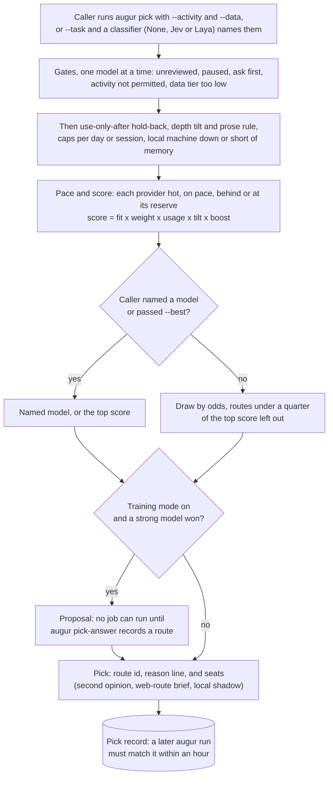

# Configuring Augur

The app covers most of this. The Rules page says what each model may do, the Routes page connects a model to the program that runs it, and Settings holds providers and keys. This page covers the files and settings behind those screens, for when you adapt Augur by hand or have an agent do it. Its tables are generated from the code, and a test fails when they stop matching it.

## Where the settings live

| What | File | Edited with |
| --- | --- | --- |
| Rules for every model, and the balance overrides | `policy` inside `config.json` in the app's settings folder. Augur writes it out to `policy.json` in `~/.augur` each time a rule changes. | The Rules page, the `augur_policy_edit` tool for models and balance settings, `augur alias set` and `augur roles` for series and roles, and by hand |
| Providers, where their keys come from, custom providers, alerts, and `agentApproval` | `config.json` in the app's settings folder | Settings, or by hand. `agentApproval` is set on the window app's Service page, or under Service on the terminal app's Dispatch page |
| Keys, when the key store is the file | `secrets.json` in the app's settings folder | `augur key set`, or by hand. [Where keys are kept](#where-keys-are-kept) has the details |
| Routes | `dispatch/routes.json` in `~/.augur` | The Routes page, `augur provider add`, the `augur_route_add` tool for a new route, or by hand |
| Service settings | Listed by `augur config` | The Service page |
| Standing instructions for jobs, the charter | The `charter` folder in `~/.augur`, or the folder `runner.charterDir` names | By hand. [Standing instructions for every job](#standing-instructions-for-every-job) has the layout |
| Series offers, refresh times and embedding notices | `alias-inbox.jsonl`, `alias-refresh.json` and `alias-flags.json` in `~/.augur` | `augur alias`. [Model series and roles](#model-series-and-roles) has the details |
| Prose requests and their drafts | `prose-queue.jsonl` in `~/.augur` | `augur prose` and the MCP prose tools. [Prose requests](#prose-requests) has the format |
| Usage resets Augur has seen, early or on schedule, and changes in reset credits | `resets.jsonl` in the app's settings folder, beside `history.jsonl`. It only grows. | Not meant to be edited. Read it with `augur resets` |
| Premium backlog items | `premium-backlog.jsonl` in `~/.augur` | `augur backlog`, or the `augur_backlog_add` tool for an agent. [The premium backlog](#the-premium-backlog) lists the fields |
| Premium gate events | `gate-ledger.jsonl` in `~/.augur`. It only grows. | Not meant to be edited. Read it with `augur gate report` |

The settings folder is `%APPDATA%\com.neostryder.augur` on Windows, `~/Library/Application Support/com.neostryder.augur` on macOS and `~/.config/com.neostryder.augur` on Linux. `AUGUR_APP_DIR` moves it and `AUGUR_HOME` moves `~/.augur`. Both the app and the service write `config.json`, so close the app and run `augur service stop` before you edit it. A hand edit to `policy.json` is overwritten the next time a rule is saved.

### Idle alert settings

The idle alert fires for a provider that Augur spends in full when all of its weekly limits have stayed under `alerts.idlePct` percent for at least `alerts.idleHours` hours. `alerts.idlePct` runs from 0 to 100 and defaults to 5, and `alerts.idleHours` runs from 0 to 168 and defaults to 6. A value outside its range falls back to the default. Both sit in `config.json` with the other alert settings, and Settings shows them under Alerts.

Idle time counts back through usage history to the last reading at or above the percent, so a window that has not started counts as idle. The alert waits while the provider's last read failed, its figures are stale, or its status page reports a problem. It names the provider, its usage, the hours idle, and the hours until the reset, repeats at most once a day, and clears when usage climbs past the percent, the window ends, or the provider stops reading ok. Out of the box it goes to the bell and Claude Code, and not to your computer's notifications or a phone's push.

## Models and route labels

Every model has a route label of the form `<provider>/<model>`, such as `codex/sol` or `claude/claude-sonnet-5-5`. The rules, the balance and `routes.json` all refer to models by label. A label also holds the model id the provider expects, so the label itself can be shorter or friendlier than the id.

A model also has a standard name, its provider id and model id joined by a slash, such as `codex/gpt-6.1-sol`. Wherever the balance names a model (tiers, preferences, the prose models, the backup lists and the seats), it accepts either the label or the standard name. A `*` in a name matches any text, so `claude/*opus*` covers every Opus a Claude provider lists. A rule written against a label takes precedence over one written against the standard name, and a standard name takes precedence over a pattern. A label is only your own name for a model, so rules written with standard names work on an install whose labels differ from yours.

Augur reads each provider's model list once a day and keeps the newest model of each family. You can also add a model by hand on the Rules page. A new model is never picked until you confirm it there and set which activities it may do and how sensitive the data it sees can be.

## Model series and roles

A series lets a model's label follow newer releases of that model, and a role limits a pick to a set of models chosen for one activity. Both are stored in the rules and change only through held edits from the owner's terminal.

### Series

A model's entry in the rules can have a `series` with a `kind` (`llm`, `image`, `speech` or `embed`) and a `pattern` that matches the model ids in the series:

```json
"series": { "kind": "llm", "pattern": "deepseek/deepseek-v*-flash" }
```

The pattern must match the whole id, ignoring case. `*` stands for any run of characters and `?` for a single one. The other characters allowed are letters, digits, dots, dashes, underscores, slashes and colons, and a pattern is at most 200 characters long. When several listed ids match, the one with the latest listing date wins, and an id without a listing date is never chosen.

```bash
augur alias init
augur alias set openrouter/deepseek-flash --kind llm --pattern "deepseek/deepseek-v*-flash"
augur alias list
augur alias refresh --label openrouter/deepseek-flash
augur alias accept <offer id> [--untested]
augur alias reject <offer id>
```

`augur alias init` prints a suggested `set` line for each model in the rules and writes nothing. Each suggestion replaces the runs of digits in the model id with `*` and sets the kind to `llm`. `augur alias set` appends a `series` edit to `policy-edits.jsonl`, and `augur roles set` and `augur roles remove` append a `role` edit. These are held edits, so at the default approval level they wait in Model rules for the owner to accept them, as a data tier change does. `augur_policy_edit` refuses both fields, so only the owner's terminal can request them. `augur alias list` prints every model that has a series with its pattern, its current id, its last refresh, and any offer or embedding notice.

### Refreshing a series

The service setting `aliasRefreshHours` sets how many hours pass between scheduled refreshes. It defaults to 24 and takes values from 0 to 8760, where 0 turns scheduled refreshes off. The service looks once an hour and refreshes when the interval has passed, provided at least one model has a series. `augur config set aliasRefreshHours <hours>` changes the setting. `augur alias refresh` starts a refresh right away for every series, or for the label given with `--label`. The command goes through the service, which runs one refresh at a time, and the agent token cannot call it.

A refresh never changes a model. If the newest matching id differs from the model's current id, it records an offer to move the label to the newer id. An `embed` series gets a notice in place of an offer, since switching embedding models means rebuilding every stored vector. The notice is written to `alias-flags.json` and added as an alert in `alerts.json`.

Refresh depends on each provider's model listing. OpenRouter's public listing has each model's listing date, the input kinds it accepts and the providers that serve it. For Codex the listing is the local `models_cache.json`, which has no dates or endpoint data, so a Codex series never yields an offer and a Codex pin cannot be checked. Copilot and the remaining providers have no listing at all. The refresh result names the providers that had no listing, and a listing that fails to load is skipped without stopping the refresh.

### Checking an offer

A new offer goes through three checks in this order. The first one to fail marks the offer `failed` and records a short reason.

1. Pinned host. If the model's rule sets `dataHandling.pinnedHost`, that host must serve the new model. Augur checks the endpoint providers in the listing first, then OpenRouter's endpoint list for the model. With no endpoint data the reason is `pin not verifiable`, and with endpoint data that leaves out the host it is `pinned provider does not serve model`.
2. Input kinds. If the old and new listing rows both state their input kinds, the new model must accept every kind the old one accepted, and otherwise the reason is `new model does not accept current input kinds`. If either row leaves them out, the offer gets the note `capabilities not compared` and moves on to the next check.
3. Smoke job. Augur sends the prompt `Reply with OK.` to the new id on the first route in `routes.json` for the label. The job is `public`, uses the `none` tool tier, and has no charter, attachments or fallback, and its activity is the first text activity the model's rule permits. Pauses, data tiers, ask-first and budgets apply as they do to any job. The pick requirement is waived for this service job and for nothing else. A completed job marks the offer tested. A job that fails or runs longer than two minutes fails the offer, and the reason leaves out the provider's reply.

Only `openai-api` and `anthropic-api` routes get a smoke job, because they can guarantee a run with no tools. The offer stays pending with `tested` set to false and a note such as `not smoke-tested: route cannot guarantee a no-tools run` when the label's route is of another kind, when the label has no route, when its rule permits no text activity, or when a rule refuses the job. `image` and `speech` series are never sent a text prompt, and their offers carry `not smoke-tested: image` or `not smoke-tested: speech`.

Each offer records an `id`, the model `label`, the current id as `from`, the newer id as `to`, the time it was made as `createdAt`, and a `status`. It may also have `tested`, a `reason` for a failure, and `notes` naming any checks that were skipped. The statuses are:

| Status | Meaning |
| --- | --- |
| `pending` | Can be accepted or rejected. An offer that was not smoke-tested is accepted only with `--untested`. |
| `failed` | A check failed and `reason` names it. It cannot be accepted. |
| `superseded` | A later refresh found a newer id for the same label, and the new offer takes its place. |
| `stale` | The label already names a different id. Accept sets this when it finds the mismatch, and a new refresh produces a current offer. |

### Accepting an offer

`augur alias accept <offer id>` checks that the label still names the offer's `from` id, and then:

- appends an `id` edit for the label to `policy-edits.jsonl`. The edit changes the model id only, and the model's name and rules stay as they are. It is a held edit, so at the default approval level it waits in Model rules, and its result is written to `policy-edit-results.json` like any other edit's.
- updates `dispatch/routes.json` straight away. A route for the label whose `options.model` is still the `from` id gets the new id, and the rest of the route is left untouched. A route that names a different id is not changed, and the command lists it so it can be fixed by hand.
- adds an `alias_swap` row to `decisions.jsonl`, the decision log in the service's data folder.

The offer is removed from the inbox once all of this succeeds. If the edit cannot be queued, the offer stays pending. If `routes.json` cannot be read or written, the edit stays queued and the offer stays pending. `augur alias reject <offer id>` removes an offer whatever its status. Accept and reject are owner commands in the terminal, and no MCP tool or agent call can perform them.

The alias files are kept in `~/.augur` next to `policy.json`:

| File | Contents |
| --- | --- |
| `alias-inbox.jsonl` | The offers, one per line. |
| `alias-refresh.json` | For each label, the newest matching id seen and when it was last refreshed. |
| `alias-flags.json` | The embedding notices. |

Augur writes each of these to a temporary file and renames it over the old one while holding a lock file. A file that cannot be parsed is copied to the same name with `.bad` appended and then read as empty.

### Roles

A role names the models allowed to take one activity. Roles are stored under `roles` in the rules, keyed by name:

```json
"roles": { "reviewer": { "activity": "review_code", "candidates": ["claude/claude-sonnet-5-5", "openrouter/deepseek-flash"], "callerChooses": false } }
```

Every candidate must be a model label in the rules, or the edit is refused. A pick with `--role <name>` ranks only the candidates and lists every other model as blocked with `not a candidate for role <name>`. Pauses, ask-first, data tiers, weights and the balance apply to the candidates as usual. A role pick still needs `--activity` and `--data`, or `--task`, and with `--task` the activity comes from the role. `augur roles` lists each role along with every candidate's data tier, pause and ask-first setting. `augur roles set <name> --activity <activity> --candidates <labels> [--caller-chooses]` adds or replaces a role, and `augur roles remove <name>` removes one.

A role without `callerChooses` draws its pick by the odds, as any pick does. A role with it takes two calls. The first, for example `augur pick --role reviewer --activity review_code --data internal`, lists the permitted candidates, makes no draw, records nothing and exits with code 2. The second adds `--model <label>` with one of those candidates and records a normal pick of it. The second call is still held to the role's candidates and to the rules, so a label outside the role, or one the rules block, produces no pick.

### Jobs with no tools

The `none` tool tier runs a job with no tools, as in `augur run <route> --tools none`. A model whose rule allows text only accepts `none` the same way it accepts `read`. The job needs an adapter that holds jobs to reading by itself. `openai-api`, `anthropic-api`, `fal-api` and `grok-exec` accept it (`grok-exec` denies every tool for the job), while `codex-exec`, `copilot-exec`, `hermes-exec`, the sandboxed adapters and `exec` refuse it with `read_not_enforceable`. The `augur_run` tool does not offer `none`.

## Adding a provider

A provider that reports usage from a JSON endpoint is a short definition in Settings. The README's [custom providers](../README.md#custom-providers) section has the format: the requests to make, which header or parameter carries the key, and the paths to read meters and balances from. A provider that needs its sign-in refreshed, or reads usage from a command-line login, is a plugin in `packages/core/src/providers` with a fixture and a test in `packages/core/test`. [Adapting Augur](adapting.md) has the steps.

Reading a provider's usage and running its models are separate. A provider added for its usage still needs a route before an agent can run work on it.

### A provider of a standard shape

Many APIs copy the OpenAI chat format or the Anthropic messages format. For those, the Add provider button on the Routes page and the `augur provider add` command each take a base URL, a model and a key and set up the rest, so you don't have to edit `routes.json` and write a custom definition by hand. The two run the same checks and make the same changes, and the command is described first below.

```bash
augur provider add openai gpt --model gpt-5
augur provider add openai-style acme --provider acme --base-url https://api.acme.example/v1 --model acme-1 --balance-url https://api.acme.example/v1/balance --balance-path '$.data.balance'
```

The first word names a preset or a shape. The presets are `openai`, `openrouter` and `anthropic`, each with its published base URL, plus `typesafe` for the Jev provider. A shape is for an API with no preset. Use `openai-style` for one that copies the OpenAI chat format. Use `anthropic-style` for one that copies the Anthropic messages format. Both of those need the API's address in `--base-url`. The third shape, `jev-style`, points the Jev provider at another service that answers `/v1/systemone`. `augur provider templates` prints the list. The second word is the route name, except for a Jev-style service, which has no route.

The command runs every check before it writes anything, and with `--dry-run` it stops after the checks and shows the plan. Otherwise it:

- adds the route to `dispatch/routes.json` with its key in the key store, and leaves the other routes in the file as they were.
- adds the model to your rules as unreviewed, under the provider you gave with `--provider` or under the preset's own name. Augur won't run the model until you set its rules on the Rules page and confirm it.
- adds a balance reading if you gave `--balance-url` and `--balance-path`. The reading is a custom provider that sends the key as a bearer token and reads one amount from the reply. OpenRouter and Jev already read their own balances, so they reject those flags. For an API whose usage takes more than one request, write a custom provider yourself.
- stores the key. It asks for the key with the typing hidden, reads the variable named by `--env <NAME>`, or reads standard input with `--stdin`, and never takes the key as an argument. If it has no way to read a key, or you pass `--no-key`, it prints the `augur key set` commands to run instead.

If the model is already in your rules, it is not added again, and the route uses the name the rules already give it. A provider id that belongs to a built-in provider can't be given a second balance reading.

On the Routes page, Add provider sits beside Add route and opens a list of services next to a short form. OpenAI, OpenRouter and Anthropic need a route name, a model id and an API key, TypeSafe (Jev) needs only the key, and the two Other entries also ask for a provider id and a base URL. More options adds the model's name in the rules, a reply limit, and a balance address and path. The Plan table under the form updates as you type and lists the route, model, key and balance that will be added, and Show the route entry opens the entry as it will look in `routes.json`. A key left empty can be saved later on the Routes page or with `augur key set <route>`. The terminal app has the same form on its Routes screen, with the plan printed above its Add provider button.

## Adding a route

A route joins a model to the program or API that runs it. The Routes page has an Add route form, and Test route sends one word through the route to show a bad path or a missing key. For a new API in the OpenAI or Anthropic format, Add provider beside it sets up the route, the model and the key together, as described in [A provider of a standard shape](#a-provider-of-a-standard-shape). Routes are stored in `dispatch/routes.json`:

```json
{
  "routes": {
    "deepseek": {
      "model": "openrouter/deepseek-v4.1-flash",
      "adapter": "openai-api",
      "options": {
        "baseUrl": "https://openrouter.ai/api/v1",
        "model": "deepseek/deepseek-v4.1-flash",
        "keySource": "env",
        "apiKeyEnv": "OPENROUTER_API_KEY"
      }
    }
  }
}
```

The route's key, `deepseek` here, is the name an agent passes to `augur run`. It starts with a lowercase letter and holds only lowercase letters, digits, `-` and `_`. `model` is the route label the rules use, so that model must be on the Rules page and confirmed before the route runs anything. `adapter` is one of the adapters below, and `options` holds its settings. A route can also have `notes`, `delegation`, a `budget` (`per` is `day`, `week` or `month`, with a limit in `usd`, `jobs` or both) and a `fallback` list of other route names to try when it cannot take a job. With the service's `runner.failover` setting on, a job that fails on the route can also run again on that list, as [Budgets and fallback routes](accounting.md#budgets-and-fallback-routes) describes.

An API route never holds its key. It either names an environment variable or reads the operating system's key store, which the Routes page fills. `augur key set <route>` fills the same store from a hidden prompt, from an environment variable you set in your own terminal (`--env <NAME>`) or from standard input (`--stdin`). `augur key status <route>` says whether a key is there without printing it. The command refuses a key typed after the route name, so a key never lands in shell history or in a chat. When the route has a `baseUrl`, `augur key set` names its host in the prompt and again once the key is saved, so you can check where the key will be sent.

### Where keys are kept

The key store is the operating system's: the Windows credential store, the macOS Keychain, or the Secret Service on Linux. Where none of those answers, the key falls back to a file only your own user can read.

| | |
| --- | --- |
| The file | `secrets.json` in the settings folder, beside `config.json` |
| The file's mode | `0600`, inside a `0700` folder. On Windows the folder's ACL applies instead |
| What is in it | The key in plain text, under a name like `dispatch.my_route`. The file is the key store, so it holds every stored key and nothing else |
| How it is written | Whole file each time, through a temporary file and a rename, so a write that is interrupted never leaves a half-written store |

Set `AUGUR_KEYSTORE=file` to use that file on every computer, not only where no keychain service answers. The variable applies to the app, the service, and the `augur key` commands, so set it in the environment each of them runs in.

```bash
export AUGUR_KEYSTORE=file
augur key set my_route    # the key goes to secrets.json
augur key status my_route # my_route: a key is stored
```

The key is in plain text, so the file's mode is the only thing keeping it private. A key in the file store is not encrypted, and it is not protected by the operating system's credential store. Keep the file out of backups and out of any folder another user can read, and remember that `secrets.json` in the settings folder is the store, so it is as sensitive as the keys it holds.

<!-- adapter-reference:start -->

#### `codex-exec`: Codex CLI

Runs codex exec. A read-only job is stated in the prompt, and Codex is not held to it. A named conversation resumes the same Codex session and keeps the tool tier of its first turn.

| Option | Value | What it does |
| --- | --- | --- |
| `model` | text | Passed to codex as its model. Leave empty for the model codex chooses. |
| `effort` | text | Passed to the harness as its effort setting. Leave empty for its default. |
| `command` | text | Full path to the harness, for when it is not on the search path. |
| `sandbox` | read-only, workspace-write, danger-full-access | The sandbox codex runs in. On Windows the stricter ones can fail to start, which is why the default is danger-full-access. |
| `prefixArgsJson` | json | A JSON array of arguments placed before exec, for wrappers. |
| `ambient` | keep, trim | Whether the harness loads its own extra instructions, tools and plugins on this route. trim turns them off, keep leaves them on, and Default follows the service's Harness context setting. |

#### `copilot-exec`: GitHub Copilot CLI

Runs the Copilot CLI in prompt mode with all tools allowed, so a read-only job is stated in the prompt and not enforced.

| Option | Value | What it does |
| --- | --- | --- |
| `model` (required) | text | The Copilot model id, for example claude-opus-5.5. |
| `command` | text | Full path to the harness, for when it is not on the search path. |
| `effort` | text | Passed to the harness as its effort setting. Leave empty for its default. |
| `envAllow` | text | Names of environment variables the harness may read, separated by commas. Nothing else from the service is passed on. |
| `ambient` | keep, trim | Whether the harness loads its own extra instructions, tools and plugins on this route. trim turns them off, keep leaves them on, and Default follows the service's Harness context setting. |

#### `grok-exec`: Grok CLI

Runs the Grok CLI, which has a real read mode, so a read job is held to reading. A named conversation resumes the same Grok session.

| Option | Value | What it does |
| --- | --- | --- |
| `model` (required) | text | The Grok model id. |
| `effort` | text | Passed to the harness as its effort setting. Leave empty for its default. |
| `maxTurns` | number | Most turns a job may take. Defaults to 60 for a read job and 400 otherwise. |
| `command` | text | Full path to the harness, for when it is not on the search path. |
| `envAllow` | text | Names of environment variables the harness may read, separated by commas. Nothing else from the service is passed on. |

#### `hermes-exec`: Hermes Agent

Runs the Hermes command line with a prompt and reads its usage file.

| Option | Value | What it does |
| --- | --- | --- |
| `model` (required) | text | The model id Hermes passes to its provider. |
| `command` | text | Full path to the harness, for when it is not on the search path. |
| `envAllow` | text | Names of environment variables the harness may read, separated by commas. Nothing else from the service is passed on. |

#### `mcode-sbx`: mcode in a Docker sandbox

Runs mcode inside a Docker sandbox on a copy of the job folder, and returns changes as a patch.

| Option | Value | What it does |
| --- | --- | --- |
| `sandbox` (required) | text | The Docker sandbox the harness runs inside. |
| `workRoot` (required) | text | The folder on this computer that the sandbox mounts as its workspace. Each job gets a copy of its folder there. |
| `model` (required) | text | The model id mcode uses. |
| `effort` | text | Passed to the harness as its effort setting. Leave empty for its default. |
| `maxSteps` | number | Most steps a job may take. Defaults to 60 for a read job and 400 otherwise. |
| `sbx` | text | Full path to the sbx command, for when it is not on the search path. |
| `sbxPrefixJson` | json | A JSON array of arguments placed before every sbx call, for wrappers. |
| `envAllow` | text | Names of environment variables the harness may read, separated by commas. Nothing else from the service is passed on. |

#### `opencode-sbx`: OpenCode in a Docker sandbox

Runs OpenCode inside a Docker sandbox on a copy of the job folder, and returns changes as a patch.

| Option | Value | What it does |
| --- | --- | --- |
| `sandbox` (required) | text | The Docker sandbox the harness runs inside. |
| `workRoot` (required) | text | The folder on this computer that the sandbox mounts as its workspace. Each job gets a copy of its folder there. |
| `model` (required) | text | The provider/model id OpenCode uses. |
| `effort` | text | Passed to the harness as its effort setting. Leave empty for its default. |
| `sbx` | text | Full path to the sbx command, for when it is not on the search path. |
| `sbxPrefixJson` | json | A JSON array of arguments placed before every sbx call, for wrappers. |
| `envAllow` | text | Names of environment variables the harness may read, separated by commas. Nothing else from the service is passed on. |

#### `openai-api`: OpenAI-style API

Sends one prompt to a chat completions, embeddings, or transcription endpoint and returns the text. No tools. Text files and images can go with the prompt.

| Option | Value | What it does |
| --- | --- | --- |
| `baseUrl` (required) | text | The API address up to and including /v1. It must start with https://, or http:// for this computer or a machine on the home network. |
| `model` (required) | text | The model id the endpoint expects. |
| `keySource` | env, store | Pick env to read the key from an environment variable you name, or store to keep it in this computer's key store. A stored key is saved on the Routes page or with `augur key set <route>`. |
| `apiKeyEnv` (required) | text | The name of the environment variable that holds the API key, when Key kept in is set to env. The key itself is never stored in a route. |
| `mode` | chat, embeddings, transcribe, moderation | chat, the default, sends the prompt as a chat. embeddings sends the prompt and any text files to the embeddings endpoint, up to 256 inputs. A prompt that is a JSON array of strings counts as one input per string. The answer is a JSON object with the model, the vector length, and the vectors in input order, and the job folder keeps a copy. transcribe sends an audio file to the transcription endpoint. moderation sends the prompt and any text or image files to the moderations endpoint and answers with a JSON object holding the overall verdict, the per-category flags, and the raw per-category scores. |
| `dimensions` | number | For an embeddings route, the number of values in each vector. Callers read it from the route so they can tell when stored vectors no longer match. |
| `maxTokens` | number | Most tokens the answer may use. Defaults to 4096. |
| `timeoutS` | number | Defaults to 900. |
| `headersJson` | json | A JSON object of request headers sent with every call. Credentials do not belong here; keep keys in the key store. |
| `requestClass` | none, cogitator | none sends nothing. cogitator sends x-cogitator-class with every call: low for background jobs, normal for a person typing at a terminal or a job marked urgent. |
| `maxInput` | number | The most characters of prompt, with any text attachments, the route takes. A bigger job is refused and goes to the route fallback, and is never cut. Leave empty for no limit. |
| `maxImageMb` | number | The largest image attachment in megabytes. Defaults to 10. |
| `maxAudioMb` | number | The largest audio attachment in megabytes. Defaults to 25. |

A local gateway such as Cogitator answers HTTP 503 with the error code `preempted` when it hands its model to a person's request. The API call then waits for the number of seconds in the `Retry-After` header (20 if the header is missing, 120 at most) and sends the request again, for up to three tries in all while the job's `timeoutS` still has time left. If every try comes back preempted, the call fails with an error message starting `preempted:`. Augur treats that error like a provider limit and moves the job to the route's fallback whatever its tool tier, since none of the job ran.

#### `anthropic-api`: Anthropic-style API

Sends one prompt to a messages endpoint and returns the text. No tools. Text files and images can go with the prompt.

| Option | Value | What it does |
| --- | --- | --- |
| `baseUrl` (required) | text | The API address. It must start with https://, or http:// for this computer or a machine on the home network. |
| `model` (required) | text | The model id the endpoint expects. |
| `keySource` | env, store | Pick env to read the key from an environment variable you name, or store to keep it in this computer's key store. A stored key is saved on the Routes page or with `augur key set <route>`. |
| `apiKeyEnv` (required) | text | The name of the environment variable that holds the API key, when Key kept in is set to env. The key itself is never stored in a route. |
| `maxTokens` | number | Most tokens the answer may use. Defaults to 4096. |
| `timeoutS` | number | Defaults to 900. |
| `headersJson` | json | A JSON object of request headers sent with every call. Credentials do not belong here; keep keys in the key store. |
| `requestClass` | none, cogitator | none sends nothing. cogitator sends x-cogitator-class with every call: low for background jobs, normal for a person typing at a terminal or a job marked urgent. |
| `maxInput` | number | The most characters of prompt, with any text attachments, the route takes. A bigger job is refused and goes to the route fallback, and is never cut. Leave empty for no limit. |
| `maxImageMb` | number | The largest image attachment in megabytes. Defaults to 10. |
| `maxAudioMb` | number | The largest audio attachment in megabytes. Defaults to 25. |

#### `fal-api`: fal video

Sends a prompt, and optionally a first frame, a last frame, and an audio track, to a fal video endpoint and saves the finished video in the job folder. The cost is checked against the route limit before anything is sent.

| Option | Value | What it does |
| --- | --- | --- |
| `endpoint` (required) | text | The fal endpoint id. |
| `usdPerSecondJson` (required) | json | A JSON object with the price in US dollars for one second of video at each resolution. Augur multiplies it by the length to check the cost before sending a job, and reports it as the job cost. |
| `keySource` | store, env | store, the default, reads the key from this computer's key store, saved with `augur key set <route>`. env reads it from an environment variable you name. |
| `apiKeyEnv` | text | The name of the environment variable that holds the key, when Key kept in is set to env. The key itself is never stored in a route. |
| `resolution` | 480P, 768P, 1080P | Defaults to 768P. |
| `duration` | number | Defaults to 5. |
| `promptExpansion` | disabled, balanced, quality | How much fal rewrites the prompt before it makes the video. Defaults to balanced. |
| `maxUsd` | number | A job whose estimated cost passes this is refused before it is sent. Defaults to 0.50. |
| `timeoutS` | number | Defaults to 900. A job still waiting then is cancelled. |
| `maxImageMb` | number | The largest image attachment in megabytes. Defaults to 10. |
| `maxAudioMb` | number | The largest audio attachment in megabytes. Defaults to 25. |

#### `exec`: Any command

Runs any command the route names, with no checks on what it does. It is off unless the service settings list it.

| Option | Value | What it does |
| --- | --- | --- |
| `command` (required) | text | The program to run. |
| `argsJson` | json | A JSON array of arguments. |
| `stdin` | prompt, none | Whether the command reads the prompt on standard input. |

<!-- adapter-reference:end -->

### Video from fal

To make a video, send a `generate_video` job to a `fal-api` route with a description of the video as the prompt. The prompt goes to fal as written, with no charter in front of it. An attached image becomes the first frame and a second image the last frame, and one audio file can go along as the target audio. Text files are refused.

Set the route up on the Routes page or with `augur_route_add`, then run `augur key set <route>` for the fal key and confirm the new model in Model rules. With these options the route makes 5-second clips at 768P:

```json
"options": {
  "endpoint": "minimax/h3-max-turbo/image-to-video",
  "usdPerSecondJson": "{\"768P\": 0.1, \"1080P\": 0.2}",
  "resolution": "768P",
  "duration": 5,
  "maxUsd": 0.5
}
```

Each job is priced before anything goes to fal, at the per-second price for its resolution times `duration`. Here that comes to $0.50, which is within `maxUsd`. Changing `resolution` to 1080P makes it $1.00, over the limit, so Augur refuses the job and sends nothing. A resolution missing from `usdPerSecondJson` is refused the same way, and the estimate is the cost the job reports.

The finished video lands in the job folder as `video.mp4`, or under the file type fal reports, and the answer gives its path and the estimated cost.

## Standing instructions for every job

Augur can put the same instructions at the top of every job's prompt, such as house rules for writing or for code. They live in a charter folder: the folder `runner.charterDir` names in the service settings, or else `charter` in `~/.augur` when that folder exists. With no folder, prompts go out as the caller wrote them.

```
charter/
  core.md            sent with every job
  engines/codex.md   sent only to jobs on that harness
  packs/code.md      sent when a job asks for the pack or a rule adds it
  charter.json       optional rules that add packs on their own
```

The engine files are named `codex`, `copilot`, `grok`, `mcode` and `opencode`. The API adapters and `exec` get `core.md` and the packs with no engine file, and Hermes gets no charter at all, since it keeps its own persona. Any of the files can be left out.

A caller adds packs with `augur run --pack code,review` or the `packs` argument of `augur_run`, and `--no-charter` or `no_charter` sends the prompt alone. `charter.json` adds packs by rule:

```json
{ "auto": [ { "tools": ["write", "full"], "pack": "code" }, { "cwdContains": "website", "pack": "web" } ] }
```

A rule adds its pack when every condition it sets holds. `tools` lists the tool tiers it applies to, and `cwdContains` is text the job's working folder must contain. Without `charter.json`, or with one that has no `auto` list, the only rule is the first one above, so write and full jobs get the `code` pack. An `auto` list replaces that rule, and an empty list turns the automatic packs off. A pack that is named but missing is skipped, and the job records a note saying so. The job record lists the parts that were sent and their length, and the prompt length it keeps counts only the caller's text. In a named conversation only the first turn carries the charter, because the harness still holds it on later turns.

Codex and the Copilot CLI add context of their own to every job. Codex turns on features such as plugins, apps, browser use and image generation, and Copilot reads custom instruction files and loads the schemas of its built-in MCP servers. Setting `runner.ambient` to `trim` turns these off, so a one-shot job spends fewer input tokens before it starts. The default, `keep`, leaves them on. A route's `ambient` option, `keep` or `trim`, overrides the setting for that route, and the other harnesses ignore both. Each job records which one applied.

## Tools and instructions for an activity

A toolkit gives the jobs of one activity a charter pack and MCP servers of their own. Toolkits live in `toolkits.json` in `~/.augur`, keyed by activity id. This one gives `reverse_engineering` jobs a pack and an MCP server:

```json
{
  "reverse_engineering": {
    "pack": "reverse-engineering",
    "mcp": {
      "disassembler": {
        "command": "node",
        "args": ["/path/to/disassembler-server.mjs"],
        "denyTools": ["run_target"]
      }
    }
  }
}
```

`pack` names a file in the charter's `packs` folder, `packs/reverse-engineering.md` here, and Augur adds it to the job's charter packs. Each server under `mcp` needs a `command`. `args`, `env` (an object of variable names and values), and `denyTools` (tools of that server the job must not use) are optional, and an entry may hold a pack, servers, or both. Pack and server names are 1 to 64 letters, digits, underscores, or hyphens.

Augur reads the file when each job starts, so an edit applies to the next job, and with no file there are no toolkits. A pack missing from the charter folder is skipped with a note. An entry Augur cannot use, such as one with a bad name, no `command`, `args` that are not a list of text, or an unknown activity, is skipped, and the job records a warning naming it.

Each adapter carries the servers its own way:

| Adapter | How the job gets the servers |
| --- | --- |
| `codex-exec` | Added for that job through `-c mcp_servers.<name>...` overrides, with `denyTools` passed as `disabled_tools`. |
| `copilot-exec` | Added for that job through `--additional-mcp-config`, with one `--deny-tool` for each denied tool. |
| `grok-exec` | The Grok CLI has no per-run option for servers, so register each server once with `grok mcp add`. Every Grok job still passes the denied tools with `--deny`. |
| Any other | The API adapters, `exec`, Hermes, and the sandboxed adapters cannot carry the servers. |

On Codex and Copilot the servers load for no other job. A job on a route that cannot carry its toolkit runs without the tools and records the warning "Route <route> cannot carry the tools for <activity>, so the job runs without them." The pack still goes to any adapter that gets a charter.

To use the example, point `args` at your own server, put the instructions in `packs/reverse-engineering.md`, and register the server with `grok mcp add` if Grok routes take reverse-engineering work. The denied tool is an example of a tool that runs the target program, which a job can be kept from using. Removing a name from `denyTools` lets jobs use that tool.

## Prose requests

`augur prose add` and the `augur_prose_add` tool put writing requests in a queue, and the service sends them to one route in batches. The README's [section on it](../README.md#prose-requests) has the commands. These service settings shape the batches, and `augur config set` changes them:

| Setting | Default | What it does |
| --- | --- | --- |
| `proseBatchSize` | `10` | The most normal requests in one batch, from 1 to 1000. A batch is due once this many are queued. |
| `proseBatchHours` | `24` | Hours, from 1 to 720, that the oldest queued normal request waits before a batch is due. |
| `proseRoute` | `claude/opus` | The route label every batch runs on. A label with no route fails the batch with a reason naming the setting. |
| `proseAutoRun` | `false` | Lets the service start a due batch by itself. Like the other service settings, only the owner's terminal and app can change it. |

The queue is `prose-queue.jsonl` in `~/.augur`, with one request per line. Augur rewrites the whole file on each change by writing a temporary file and renaming it over the old one. A request carries a data tier, `internal` unless the request gives `public`, `sensitive`, or `regulated`, and one of these statuses:

| Status | Meaning |
| --- | --- |
| `queued` | Waiting for the next batch. |
| `awaiting-approval` | An urgent request that needs `augur prose approve <id>` before it can run. |
| `running` | In a submitted batch. A service restart puts it back to `queued`. |
| `drafted` | Done. `result` holds the text, the model, the cost, and the job id. |
| `failed` | The job failed, or the model's reply had no usable draft for this request. |

Every status change adds an entry with the time and a note to the request's `statusLog`.

A normal batch is due when `proseBatchSize` normal requests are queued or the oldest has waited `proseBatchHours`, and it takes up to `proseBatchSize` of them, oldest first. Approved urgent requests do not wait for that. The next run sends all of them as their own batch and leaves the normal requests queued. Within a batch, requests with the same data tier share one `draft_prose` job on `proseRoute`, and the model returns a JSON array of drafts keyed by request id. When one job fails or runs past 15 minutes, its requests are marked `failed` and the other groups carry on.

`augur prose run` passes the owner's caller to the service, and a run that arrives without it is refused. With `proseAutoRun` on, the service also starts due batches itself under its own service caller, except while an urgent request is still waiting for approval. Augur does not keep a batch's prompt with its job, and the request text stays in `prose-queue.jsonl`.

The job gets read tools and text-only output, and it runs in a fresh, empty folder under `prose-scratch` in the service's data folder, which is deleted afterward. The job never sees the repository, so a request's `repo` field is only a label. Its data tier is the group's tier, raised to `regulated` if the prompt mentions students, and to the task classifier's tier if a classifier is set and rates the prompt higher. Pauses, data tiers, ask-first, the pick rule, and budgets apply as they do to any job. A model whose rule allows text only must run on an adapter that holds the read-only tier itself. `codex-exec` cannot, so a prose job for such a model on a Codex route is refused with `read_not_enforceable`. Point `proseRoute` at a route whose adapter enforces read-only, such as an API route, or change that model's output rule.

## Tuning the balance

The balance leans each pick toward the models that suit the work, keeps each provider that reports a usage window near its pace, boosts the providers with allowance left to spend, and holds backup routes in reserve. The README's [section on it](../README.md#how-a-pick-balances-models) describes how. Its settings are the `balance` object of the rules. Each setting has a shipped default, a value of the wrong type is ignored, and `null` removes a shipped entry from a map.



Each pick runs through the steps in the order `packages/dispatch-protocol/src/pick.ts` applies them, from per-model gates and caps down to the pace and score in `packages/dispatch-protocol/src/pace.ts` and a weighted draw that leaves out any route under a quarter of the top score. The training-mode branch, which can hold a strong-model pick as a proposal until you answer it, stays dormant unless you switch it on, because training mode ships turned off.

Pace settings sit in one block per provider, `pace.<provider>`, with `band`, `reserve`, `hot.strong`, `hot.light`, `behind.strong`, `behind.light` and `boost`. A provider with no block of its own gets the built-in values: a band of 10 points, a reserve of 90%, hot multipliers of 0.8 for strong routes and 1.25 for light ones, behind multipliers of 1.25 and 0.85, and a boost of 1.5. Claude's built-in band is 5. The older `claude.*` settings still work as another spelling of `pace.claude.*`. The first time Augur saves the rules, it moves those numbers into `pace.<provider>` and marks the section `"schema": 2`, keeping any value already set under `pace`, and a file that has not been saved since is read the same way.

The `profile` setting chooses the base rules the other settings build on. `classic` is the original rule set, with tiers, preferences and seats for one particular stack, and an install that names no profile uses it. A new install starts on `neutral`, where weights, pauses and data tiers apply as always and only Claude's own models have a tier, so the pace lean moves work toward Sonnet when Claude runs ahead and toward Opus when it runs behind. Neutral has no preferences, excluded names or seats, so you add the ones you want. The unused-allowance boost and the draw work the same under both profiles.

`boostFitFloor` keeps the boost off routes the caller rated as a poor fit, and `draw.enabled` and `draw.tail` control the draw. With the draw on, `augur pick` and `augur_pick` choose a route at random by its odds, its score over the sum of the scores still in the draw, and a route under `draw.tail` of the top score is left out. With the draw off, every pick takes the top score.

An agent can change a balance setting through `augur_policy_edit` with `field` set to `balance` and a `path`, as [mcp.md](mcp.md) describes. `agentApproval` in `config.json` decides how many of an agent's edits wait for the owner. `all` holds every edit, `risky` (the default) holds the edits that change what data a model may see or whether it runs, and `none` applies everything. The setting is changed on the window app's Service page or under Service on the terminal app's Dispatch page, and no tool an agent can call reads or changes it. An agent's `augur_route_add` follows it as well: at `all` nothing is written, and at `risky` and `none` the route is added at once with its model unreviewed.

To move a setup to another computer, run `augur profile export profile.json` on the first one. The file holds the balance settings, the routes and a `models` section with each model's rules, and never a key. For each model it keeps the id, the name, and the activities, data tier, ask first, output, sandbox, effort, cost and data handling. It leaves out the model's status, pause, notes and thresholds, and any field the model inherits from its provider. On the second computer, `augur profile import profile.json` reads the whole file before it changes anything, and if an entry is wrong it stops, names it and writes nothing. If the file is good, the balance settings go through the edit inbox, where the approval setting treats them like an agent's edits, and routes with new names are added. A model this computer lacks is added unreviewed with the file's rules filled in, so it cannot run until you confirm it in Model rules, and a provider this computer does not know is added for its rules alone. A route or model that already exists stays as it is, and the summary names it. `--dry-run` shows the plan without writing anything. Each new route then needs its key from `augur key set <route>`. A file with no `models` section imports the balance settings and routes alone.

To set the balance by hand, put the object in `config.json` under `policy`, with the app closed and the service stopped. Augur copies it into `policy.json` the next time it saves a rule or a setting, and the service reads that file for every pick. This example holds monthly Copilot spend to $90 with a stop at $150, never picks anything with `astra` in its name, and adds a preference:

```json
{
  "policy": {
    "balance": {
      "fallback": { "aim": 90, "cap": 150 },
      "exclude": ["astra"],
      "prefer": { "minimax/m3": { "research": 1.3 } }
    }
  }
}
```

`augur balance` shows what the settings are doing. `augur_pick_preview` and `augur pick-preview` rank a task against them and show each route's odds without drawing or recording a pick, and `augur_pick_preview` can also apply edits that have not been made yet. When the reset ledger holds early resets for a provider, the report adds a sentence such as `2 early resets recorded.` after that provider's headroom line.

### Task weight, caps, and training mode

Every pick has a depth that says how much the task weighs. Routine work is glue, plumbing, renames, and boilerplate, and everyday work is review, research, summaries, and modest changes. Deep work is hard reasoning, a substantial feature, or a tricky bug. Core work is an engine, core logic, security-critical code, or anything costly to get wrong. The `tilt.<depth>.strong` and `tilt.<depth>.light` multipliers turn the depth into a lean, so under the classic profile a strong route scores 0.35 times as much on routine work and 1.6 times as much on core work. A caller sets the depth with `--depth` on `augur pick` or `depth` on `augur_pick`. Otherwise the decision backend judges it from the task description, with a keyword check when the backend gives no answer, and the activity's `depth.<activity>` setting applies when neither settles it.

`caps.<route>` limits how a route is used: `perDay` counts picks in the last 24 hours, `perSession` counts picks in one caller session, and `parallel` sets how many jobs of the route run at the same time. A route at a pick limit drops out of the ranking with a `capped` reason, and a caller that names it still gets it. The parallel limit counts jobs instead of picks, so it holds when one pick starts several jobs or when a caller names the route, and a job over it waits in the queue until a running one finishes. No route is capped until you add one.

Training mode checks Augur's picks with you before you trust them. With `training.enabled` on, a pick on a strong route, or on any route listed in `training.askRoutes`, comes back as a proposal (`training.askTiers` sets which tiers ask). No job can run on a proposal until it is answered. You answer it with `augur pick-answer <pick id> --model <route>`, naming either the proposed route or the one you would rather use, and `--why <text>` keeps your reason. Augur counts your answers for each kind of work, meaning an activity at one depth such as `write_code:deep`. Once a kind of work has at least 10 answers (`min`) and 90% (`agree`) of its newest 20 (`window`) agree with the proposal, it stops asking. One pick in 10 (`spot`) still asks so the count stays current, and core work on an asked route asks every time, as does anything in `askRoutes`. Running a job on a different model than an unasked pick counts against the proposal. Your past choices also nudge each route's fit for that kind of work, from 0.85 for a route you never chose to 1.15 for one you always chose. Answers come only from the command line, since the MCP server has no tool for them.

This example lets `codex/sol` take six picks a day, two in one session, and run two jobs at once, and turns training mode on with its default thresholds:

```json
{
  "policy": {
    "balance": {
      "caps": { "codex/sol": { "perDay": 6, "perSession": 2, "parallel": 2 } },
      "training": { "enabled": true }
    }
  }
}
```

### The premium gate

The premium gate holds the most expensive models for work the owner asks for. Any label in `gate.premium` acts as ask first, whatever its own rule says, so a pick skips it with the reason `ask-first: owner approval required` unless the caller names it. Out of the box the list holds `codex/sol`, `claude/opus`, `xai/grok`, `copilot/gpt-6.1-sol`, `copilot/claude-opus-5.5`, `copilot/grok-4.7` and `copilot/gemini-4-argon`. Entries must match route labels exactly; a standard name or a `*` pattern covers nothing here. Setting the balance's `enabled` to `false` leaves the gate on.

Every pick and run carries a caller intent, `interactive` or `automated`. `augur pick`, `augur pick-preview` and `augur run` take `--caller`, and without it they read the `AUGUR_CALLER` environment variable and then fall back to `interactive`. The service puts each job's own intent in that job's `AUGUR_CALLER`, so an `augur` command inside a job is always automated, whatever `--caller` says, and `augur run --allow unpicked` is refused there. This is best effort: a process that clears its environment still holds the owner token, which is outside this feature's trust model. On a route that grants `delegation`, the jobs a job starts are tied to its chain, and each one is automated whenever the root job was, whatever its own request says. Every request made with the agent token is automated, and that includes everything from the MCP server. An automated caller never gets a premium label from a pick, even by naming it, and a run on one is refused with `Premium models are not used for automated tasks` and the cheapest permitted route for the same activity and data tier. The only automated path to a premium label is the service's own release of a backlog item the owner approved, described in [the premium backlog](#the-premium-backlog).

For an interactive caller the wait can lift without a name, but only for labels in `gate.paceLift`, which ships as `codex/sol`, `xai/grok` and `claude/opus`. Copilot labels in that list are ignored and `augur balance` says so under Notes, so a Copilot premium model runs only when it is named. The pace lift opens for a provider once every weekly window it reports for the whole subscription (a window scoped to one model does not count) runs `gate.open` points or more behind pace (20 by default), where the gap is the share of the week that has passed minus the share used. It stays open until the gap drops below `gate.close` (10 by default), and a provider with no fresh weekly reading stays closed. While it is open, an interactive pick can choose that provider's lifted labels and adds a note such as `ask-first lifted: claude is 24 points behind pace`, and an interactive run on one of them needs no name. A run lifts only when its request declares the `interactive` intent, so a request with no declared intent is refused like an automated one.

A surplus window lifts the same labels before a reset would waste allowance. Only providers in `gate.surplus.countdown` get one: Claude and Grok by default, where `grok` and `xai` both mean the `xai` labels. Codex and Copilot entries are dropped with a note, so Codex has only the pace lift and Copilot has neither. The window follows the provider's weekly meter that resets first, counting meters the provider marks inactive and skipping meters scoped to one model. It opens when a fresh reading puts that reset `gate.surplus.hours` hours away or less (12) with at least `gate.surplus.open` points of the week unused (10). It closes when unused falls below `gate.surplus.close` (5) or when the reset it opened against passes, even if a later reading shows a fresh meter. A window that closes and opens again before the same reset keeps the points it already spent. A stale reading cannot open a window, and a window that goes stale stays open until its reset but releases no backlog items. A `gate.surplus.hours` of 0 turns windows off.

A window's budget is its unused points minus `gate.surplus.margin` (5) and minus the points spent since it opened. A released backlog item spends its estimate, or 1 point without one, and every other completed job on a premium label spends 1 point. While a window is open on a fresh reading and has budget left, an interactive caller gets the same lift as behind pace: a pick can choose the provider's labels in `gate.paceLift`, with a note such as `ask-first lifted: claude resets in 7 hours with 18 points unused`, and a run on one needs no name. The note appears only when the lift let in a label the caller did not name. A stale or spent window lifts nothing. `augur gate status`, the Surplus windows lines of `augur balance`, the dashboard's gate row and the terminal app's usage page describe each countdown provider's window with one of these lines.

| Line | Meaning |
| --- | --- |
| `<u> of <open> points unused` | Under `gate.surplus.open` points of the week are left, so no window will open |
| `window opens in <h>h`, `window opens in <m> min` | Enough of the week is unused, and the window opens when the reset is `gate.surplus.hours` away. Hours are whole and rounded down, and the last hour counts in minutes |
| `window open, closes at reset, <n> points budget` | The window is open and `<n>` points of budget remain |
| `window spent, closes at reset` | The window is open and its budget is used up |

The service keeps the gate's state in `gate-state.json` in its data folder: which pace lifts are open, how long each has been open this week, and for each window its reset time, the points spent and whether its reading is stale. The service checks the gate every half second, and an interactive pick that is not a preview, `augur balance` run by the owner and each release check do the same. The file is rewritten, through a temporary file, only when a pace lift, a window or the week changes. `augur gate status`, `augur gate report`, previews, dry runs and every call made with the agent token only read it.

Gate events go to `gate-ledger.jsonl` in `~/.augur`, one JSON line each, with no task text. The file only grows. Each line has the time, the kind, the label, the provider and the caller, plus what applies to that kind: the pace gap, the pick or job id, the dollar cost, the window's hours left, unused points and budget, or the backlog item id and its `estimatePoints`.

| Kind | Written when |
| --- | --- |
| `blocked` | An interactive pick left out a premium label that was waiting for approval |
| `denied-automated` | An automated pick left out a premium label |
| `lifted` | The pace lift let an interactive pick consider a label the caller did not name |
| `surplus-lifted` | A surplus window let an interactive pick consider a label the caller did not name |
| `surplus-open`, `surplus-close` | A provider's surplus window opened or closed |
| `approved` | The owner recorded an approval with `augur gate record` |
| `released` | The service released a backlog item |
| `ran` | A job on a premium label completed |
| `lower-ran` | A job on a light-tier label completed after it was picked while a premium label waited for approval |

`augur gate status` prints one line per provider with a premium label: whether its pace lift is open, how far behind pace it runs, its window, the gated labels and the last recorded approval, then a line counting the backlog items that wait for your approval. The window app shows each of those items on the dashboard with an Approve button, and the terminal app lists them with their ids at the top of the usage page. `augur gate report` prints JSON with a count for each ledger kind, the premium and lower-tier dollar cost for each activity, the hours each pace lift has been open this week, and the current window lines. `augur gate record --kind approved --route <label> --scope this|task|session [--note <text>]` adds an `approved` line for an approval given somewhere else, such as in a conversation with an agent. It grants nothing, so the run still needs a name or a lift. The label has to be in `gate.premium`, and the note is cut to 200 characters. An agent can read the status and the report, and only the owner can record.

The service checks every 30 seconds whether the backlog needs you. Each item in `awaiting-approval` gets an alert of the kind `backlog` (Premium tasks need you in the alert settings), and so does a surplus window with under 12 hours to its reset, points still unspent and no item queued, running or awaiting approval. Alerts go to system notifications, the app feed and the phone by default, and never to Claude. A dismissed alert stays dismissed while its cause holds, and one whose cause ended is removed from the feed.

### The premium backlog

Premium work that can wait for a surplus window goes in the premium backlog. It is the file `premium-backlog.jsonl` in `~/.augur`, with one JSON object per line and no keys in it. The service rewrites the whole file each time through a temporary file, holding a `.lock` file next to it meanwhile and creating the folder first if it is missing. The lock file holds the process id of its owner. When another lock is there, the service waits up to 2 seconds for it, and takes it over at once if that process is gone, or once the lock is more than 30 seconds old even if its process still runs. A line it cannot read stays in the file untouched, and `augur backlog status --json` counts it.

| Field | What it holds |
| --- | --- |
| `id`, `createdAt` | A random id and the time you added the item, both filled in by the service |
| `author` | `owner` or `agent`, from the token that added the item |
| `requester`, `repo`, `task` | Who wants the work, the repository it belongs to, and a short description |
| `prompt` | `{"text": "..."}` or `{"file": "..."}`. A file has to exist inside `cwd` or a folder in `promptRoots` when the item is added, and in an item file it is given as an absolute path |
| `activity`, `data` | The activity and data tier, the same values `augur run` takes |
| `route` | A route in `routes.json` whose model is in `gate.premium` |
| `lower` | Optional. A cheaper route for the same work, kept with the item for reference. The release does not use it |
| `estimate` | Optional. How many points of the provider's weekly allowance you expect the work to use, 0 to 100, the same unit as a window's budget. Leave it out and the item counts as 1 point |
| `deadline` | Optional. An ISO date. An item still waiting for approval or still queued then becomes `expired` |
| `cwd` | The job's working folder, an absolute path to a folder that exists when the item is added |
| `tools`, `output` | The tool tier and output mode, the same values `augur run` takes |
| `status`, `statusLog` | Where the item stands (`awaiting-approval`, `queued`, `running`, `done`, `failed`, `cancelled` or `expired`), and each change with its time and a note |
| `result` | After release, the job id, and the points charged as `cost` |
| `provider` | After release, the provider the item runs on |

You supply the fields from `requester` to `output`, and the service fills in the rest. It turns away an item with any other field, including `author`, `status` or `released`, and it checks that `cwd` and any prompt file exist when the item is added. Your own items start out `queued`. An agent's items start as `awaiting-approval` and wait there until you run `augur backlog approve <id> --yes`, which refuses an item whose deadline has passed. `augur backlog add` run inside a job, where `AUGUR_JOB_ID` or `AUGUR_IN_JOB` is set or `AUGUR_CALLER` is `automated`, adds the item as an agent's, so it waits for approval as well, and `approve`, `run` and `drop` refuse to run from inside a job. This is a convenience and not a guard, because a process that clears those variables still holds the owner token. A released item shows `running` while its job is alive and `done`, `failed` or `cancelled` when the job ends, and a job the service loses fails its item.

While any item is queued or waiting for approval, the service runs a release check at most once every 5 seconds, and `augur backlog run` runs one at once. The check does nothing without a `policy.json`, and a policy with no `balance` section uses the shipped gate and window settings. First it marks `expired` every item waiting for approval or queued whose deadline has passed, and an expired queued item also gets an `alert` event in the job store, which is the only notice it gives. Then it walks the queued items, earliest deadline first, items with no deadline last, and older items before newer ones. Each item it would release takes its estimate out of the provider's remaining budget and holds the provider's one running slot before the next item is weighed. `augur backlog status`, `augur backlog run --dry-run` and the real release all use this same walk. Some problems fail an item, with the reason in its log: a Copilot route, a model missing from `gate.premium`, data more sensitive than the model may see, an activity the model is not allowed, or a working folder that is gone. Others hold it in the queue: a route that is not in `routes.json`, a model you have not confirmed, a route that cannot run right now, a closed or stale window, a budget too small for the estimate, or another backlog item already running for the provider. A held item gets a note unless the latest line of its log says the same. An item that passes is marked `running` with the note `releasing` and submitted on its route as an automated job labelled `backlog:<id>`, with no fallback and the released flag set. Every other rule still applies, and the table below shows which refusals send the item back to the queue and which fail it.

| Refusal codes | What happens to the item |
| --- | --- |
| `model_unreviewed`, `no_policy`, `adapter_unavailable`, `sandbox_required`, `isolation_required`, `text_only`, `read_not_enforceable`, `unknown_route`, `unknown_model`, `model_paused`, `ask_first`, `quota_denied`, `pace_denied`, `not_picked`, `budget_exhausted`, `jobs_off` | It goes back to `queued`, and each reason is logged once |
| `activity_not_permitted`, `data_tier_too_high`, `bad_request`, `prompt_too_large`, `attachment_rejected`, `depth_exceeded`, `descendants_exceeded`, `delegation_not_granted` | It fails with the reason |

A release takes the estimate out of the window's budget, adds a `released` line to the gate ledger, puts `released from premium backlog item <id>` in the job's events, and saves the provider on the item, so deleting the route does not free that provider's slot. A provider that never gets a window, such as Codex, keeps its items in the queue until their deadline, and so does an item whose route was deleted. At startup the service checks each `running` item against its job. A job that is still alive keeps the item `running`, a finished job sets it to `done`, `failed` or `cancelled`, and a missing job sends it back to `queued` with the note `service restarted`. An item whose job id was never saved is matched to its job by the `backlog:<id>` label, so a crash between submitting and saving does not release it twice.

| Command | What it does | Who can run it |
| --- | --- | --- |
| `augur backlog add --file <item.json>` | Adds the item described in the file. A relative path to the file is read from the current folder | You and agents |
| `augur backlog add --requester <name> --repo <path> --task <text> (--prompt <text> \| --prompt-file <file>) --activity <a> --data <tier> --route <route> --cwd <dir> --tools <tier> --output <mode>` | Adds an item from flags. Relative `--cwd` and `--prompt-file` paths are resolved from the current folder and saved as absolute paths. `--estimate <points>` and `--deadline <date>` are optional, and `lower` can only be set in an item file | You and agents |
| `augur backlog list [--status <status>]` | Prints a line for each item with its id, author, status, route, data tier, tools, output, working folder, prompt source (the file, or the length of inline text), estimate, deadline and task, then its last five log entries. `--status` limits it to one status | You and agents |
| `augur backlog status` | Prints the count for each status as a JSON line, then every item as `list` shows it, then `Fitting:` and `Next window:` lines holding the items an open window would release now and the countdown provider that resets next. `--json` prints the whole result as JSON, with the number of lines that could not be read | You and agents |
| `augur backlog run [--dry-run]` | Runs a release check right away. With `--dry-run` it lists the items it would release, hold, expire and fail, with the reason for each hold and failure, and writes nothing: not the items, their logs or the gate state | You |
| `augur backlog approve <id> [--yes]` | Without `--yes`, prints the item, the first 600 characters of an inline prompt and its last log entries, and changes nothing. With `--yes`, moves an agent's item from `awaiting-approval` to `queued` and prints it. An item past its deadline is refused | You |
| `augur backlog drop <id>` | Deletes an item | You |

Agents get add, list and status through the agent token or the MCP tools, and the MCP results carry the same details as `augur backlog list`. Nothing an agent can call approves, runs, releases or drops an item. Only the service sets the released flag, and `augur run --released` or a `released` field in any request from outside the service is turned away.

### Every balance setting

<!-- balance-reference:start -->

| Setting | Value | What it does |
| --- | --- | --- |
| `profile` | classic or neutral | The starting rules the other settings sit on. Classic is the original rule set and is what an install with no profile uses. Neutral gives a tier only to Claude's own models, so pace moves work between Opus and Sonnet and leaves other routes alone. Both profiles boost providers with unused allowance. |
| `enabled` | true or false | Switches the whole balance off, pace and the boost with it. Scores then come from fit, weights and usage alone. |
| `gate.premium` | list of routes | Routes that need owner approval for interactive picks and are unavailable to automated callers. |
| `gate.paceLift` | list of routes | Ask-first routes whose approval wait can lift for interactive callers while their provider is behind pace. |
| `gate.open` | points | The provider pace gap that opens its premium gate. 20 by default. |
| `gate.close` | points | The pace gap below which an open premium gate closes. 10 by default. |
| `gate.surplus.hours` | hours | How close a trusted provider reset must be for a surplus window to open. 12 by default; 0 disables windows. |
| `gate.surplus.open` | points | Unused allowance needed to open a surplus window. 10 by default. |
| `gate.surplus.close` | points | Unused allowance below which an open surplus window closes. 5 by default. |
| `gate.surplus.margin` | points | Allowance reserved from the surplus run budget. 5 by default. |
| `gate.surplus.countdown` | provider ids | Providers whose reset countdown can open a surplus window. Claude and Grok by default; Codex and Copilot are ignored. Grok and xai both resolve to xai. |
| `boostFitFloor` | number from 0 to 1 | The lowest caller fit that still gets the unused-allowance boost. A route the caller gave no fit for is boosted. |
| `draw.enabled` | true or false | Draws each pick at random by its odds. Off, every pick takes the top score. |
| `draw.tail` | number from 0 to 1 | The share of the top score a route needs to stay in the draw. A route below it gets 0% odds and stays in the ranking. |
| `depth.<activity>` | routine, everyday, deep or core | The depth an activity gets when neither the caller nor the task description gives one. Out of the box, write_code and reason_critique are deep and every other activity is everyday. |
| `tiers.<route>` | strong or light | The tier of a route. A route with no tier is never tilted. Set a shipped entry to null to remove it. |
| `exclude` | list of words | Route labels, or ids containing any of these words, that are never picked unless a caller names one. |
| `tilt.deep.strong` | number above 0 | The score multiplier for a strong route on deep work. |
| `tilt.deep.light` | number above 0 | The score multiplier for a light route on deep work. |
| `tilt.everyday.strong` | number above 0 | The score multiplier for a strong route on everyday work. |
| `tilt.everyday.light` | number above 0 | The score multiplier for a light route on everyday work. |
| `tilt.routine.strong` | number above 0 | The score multiplier for a strong route on routine work, such as renames, plumbing, and boilerplate. |
| `tilt.routine.light` | number above 0 | The score multiplier for a light route on routine work. |
| `tilt.core.strong` | number above 0 | The score multiplier for a strong route on core work: an engine, core logic, security-critical code, or anything costly to redo. |
| `tilt.core.light` | number above 0 | The score multiplier for a light route on core work. |
| `caps.<route>.perDay` | count | The most times this route can be picked in 24 hours. At the limit it is left out of picks unless a caller names it, and picks that named it do not count. 0 turns the limit off. |
| `caps.<route>.perSession` | count | The most times this route can be picked in one caller session. Named picks do not count here either, and 0 turns the limit off. |
| `caps.<route>.parallel` | count | The most jobs this route runs at the same time, however many picks started them. A job over the limit waits in the queue until one finishes, and a named route is held to it too. 0 turns the limit off. |
| `training.enabled` | true or false | Turns training mode on. A pick on a route in training.askTiers or training.askRoutes then waits for a person to confirm it or choose another route with augur pick-answer, and no job can run on it until then. Off by default. |
| `training.agree` | number from 0 to 1 | How often your answers must match the proposal, as a share of the recent ones, before a kind of work stops asking. A kind of work is an activity at one depth, such as write_code at deep. 0.9 by default. |
| `training.window` | number of 1 or more | How many of the newest answers for a kind of work count toward its agreement share. 20 by default. |
| `training.min` | number of 1 or more | How many answers a kind of work needs before it can stop asking. 10 by default. |
| `training.spot` | count | After a kind of work stops asking, one pick in this many asks anyway. 10 by default, and 0 means it never asks again. |
| `training.askDepths` | list of words | Picks at these depths ask every time on an asked route, even after the answers agree. Core by default. |
| `training.askTiers` | list of words | Picks of routes in these tiers ask until the answers agree often enough. Strong by default, so light routes never ask. |
| `training.askRoutes` | list of routes | Routes that ask on every pick, whatever their tier. Empty by default. |
| `prose.models` | list of routes | The routes that write the best prose. They get prose.tilt on draft_prose at any depth. |
| `prose.tilt` | number above 0 | The multiplier a prose route gets on draft_prose in place of the depth tilt. |
| `prose.pace.enabled` | true or false | Turns the prose pace switches on or off. Each provider with a route in prose.models has its own switch. While a provider's switch is on, draft_prose moves off its prose routes if another route can take the work. |
| `prose.pace.ahead` | points | How many points a provider's stricter window must run ahead of its pace marker, with nothing used, before draft_prose moves off that provider. The lead needed shrinks as usage climbs. |
| `prose.pace.aheadAtReserve` | points | The lead that moves draft_prose off a provider once a window reaches that provider's reserve. Between no usage and the reserve, the lead needed falls in a straight line from prose.pace.ahead to this value. |
| `prose.pace.returnAt` | points | The lead at or below which draft_prose returns to a provider. Zero means the provider is back on its pace marker. |
| `claude.provider` | provider id | The provider the older claude settings apply to, claude unless set. Its reserve can send work to backup routes, and while its figures are missing it leans to its light models. Pace settings for every provider sit under pace.<provider>. |
| `claude.band` | points | The older spelling of pace.claude.band. Other providers set theirs under pace.<provider>. |
| `claude.reserve` | percent | The older spelling of pace.claude.reserve. Other providers set theirs under pace.<provider>. |
| `claude.hot.strong` | number above 0 | The older spelling of pace.claude.hot.strong: Claude's multiplier for a strong route while it runs ahead of pace. |
| `claude.hot.light` | number above 0 | The older spelling of pace.claude.hot.light: Claude's multiplier for a light route while it runs ahead of pace. |
| `claude.behind.strong` | number above 0 | The older spelling of pace.claude.behind.strong: Claude's multiplier for a strong route while it runs behind pace. |
| `claude.behind.light` | number above 0 | The older spelling of pace.claude.behind.light: Claude's multiplier for a light route while it runs behind pace. |
| `pace.<provider>.reserve` | percent | The percent of a window at which optional work moves off that provider while another provider can take it, 90 by default. Claude's work can then go to a backup route. Any other provider's work goes only to a subscription route. |
| `pace.<provider>.band` | points | How many points of usage ahead of or behind the share of the window that has passed still count as on pace for that provider. 10 by default and 5 for Claude. |
| `pace.<provider>.hot.strong` | number above 0 | The multiplier for that provider's strong routes while it runs ahead of pace, 0.8 by default. |
| `pace.<provider>.hot.light` | number above 0 | The multiplier for that provider's light routes while it runs ahead of pace, 1.25 by default. |
| `pace.<provider>.behind.strong` | number above 0 | The multiplier for that provider's strong routes while it runs behind pace, 1.25 by default. |
| `pace.<provider>.behind.light` | number above 0 | The multiplier for that provider's light routes while it runs behind pace, 0.85 by default. |
| `pace.<provider>.boost` | number of 1 or more | The most the unused-allowance boost can multiply that provider's scores, reached at a fresh window and shrinking as its fullest window fills. 1.5 by default, and 1 turns it off. |
| `fallback.providers` | list of provider ids | Providers whose routes are backups. They compete only when no subscription route can take the work. |
| `fallback.routes.<route>` | list of activities | A single route that is a backup for these activities only. |
| `fallback.anthropic` | list of routes | Claude models reached through a backup provider. They are allowed once Claude is at its reserve, since a Claude stop halts everything. |
| `fallback.aim` | dollars | The monthly spend on backup routes the router tries to stay under. A pick mentions the spend once it passes this. |
| `fallback.cap` | dollars | The monthly spend at which backup routes are dropped, except the Claude models in fallback.anthropic while Claude is at its reserve. |
| `fallback.margin` | dollars | Added to the last known spend, because the provider's figures lag. |
| `prefer.<route>.<activity>` | number above 0 | What a route is known to be good at: a multiplier on one activity. Set a route or an entry to null to remove it. |
| `seats.second.models` | list of routes | The routes that give a second opinion, in order. The first one that is allowed for the task is named. |
| `seats.second.skip` | list of activities | Activities too small to need a second opinion. |
| `seats.web.<activity>` | list of routes | The free web routes a pick recommends for an activity, in order. The calling session drives the browser. Set an activity to null to remove it. |
| `seats.shadow` | route | The local model that answers beside a pick made by a reasoning model, so the two answers can be compared. |
| `seats.jev.route` | route | The classifier route that is first for the activities listed next. |
| `seats.jev.activities` | list of activities | The activities the classifier route is first for. |
| `seats.jev.tilt` | number above 0 | The multiplier the classifier route gets on those activities. |

<!-- balance-reference:end -->

A route that no setting names is never tilted, though its provider's boost still applies to it, so a stack with different routes still works. The `neutral` profile, which a new install gets, names only Claude's own Opus, Sonnet and Haiku models and tilts nothing else. The `classic` profile tilts the routes of the maintainer's own stack. To tilt your own routes on classic instead, add them to `tiers` and `prefer`, and set the shipped entries to `null`.
