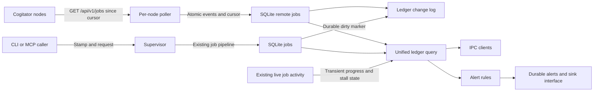

# Job ledger

The job ledger is a metadata record that the service keeps in its existing `state.db`. Augur jobs stay in the existing `jobs` rows, which gain a `ledger` metadata column, and remote work goes in `ledger_remote`. The service merges the two to answer a ledger query. The CLI and MCP server stamp submissions and query the ledger. The desktop app, the service-served PWA, and the terminal Jobs page read it.



## Record

The wire types and validation functions are exported from `packages/dispatch-protocol/src/job-ledger.ts`. `LedgerJob` wraps an Augur `JobRecord` by reference through `node`, `localId`, and `id`, and it carries no copy of the request or result.

| Field | Meaning |
| --- | --- |
| `id`, `node`, `localId` | The global id is `<node>:<localId>`. Each part is 1 to 128 ASCII letters, digits, dots, underscores, or hyphens. |
| `kind` | One of `augur-job`, `media-job`, `llm-request`, `model-load`, `model-evict`, `install`, or `download`. |
| `state` | One of `queued`, `running`, `stalled`, `done`, `failed`, `canceled`, or `node-lost`. |
| `stamp`, `attribution` | Caller metadata and where it came from, described below. |
| `summary`, `summarySource` | One ASCII line of at most 120 characters. The source is `caller` when the caller supplied it, `local-model` when a local model wrote it, or `none` when the line is empty. |
| `route`, `model`, `activity` | The route, the served or configured model, and the activity. Route and model can be null. |
| `createdAt`, `startedAt`, `endedAt`, `updatedAt`, `lastActivityAt` | Milliseconds since the Unix epoch. Start, end, and last activity can be null. For local jobs, `updatedAt` holds the latest execution-state timestamp. |
| `durationMs` | End minus start, or end minus creation for a job that never started. It is null while the job is active. Clients compute elapsed time from their current time and `startedAt ?? createdAt`. |
| `activityLine` | A live progress line of at most 120 ASCII characters. It is transient, and the ledger does not persist it. |
| `parentId`, `retryOf`, `retriedAs` | Qualified ledger ids, or null. Local records can also carry the optional `replayOf` link. |
| `usage` | Token counts and cost as the provider reported them, or null. Augur's derived and imputed figures come separately from the existing accounting call. |
| `exitReason` | A metadata exit reason, or null. Local jobs put their execution state here instead of harness error text. |
| `failureReason` | Present only on a failed job. One line of plain ASCII, at most 300 characters, with no prompt text. For a `codex-exec` job it is the final error from the job's Codex session log, or `exit N` when that log is missing or unreadable. For a Grok or mcode job that reports an error result it is that error's message, and mcode adds its error code when present. |
| `failureCode` | Present only on a failed job when the engine reported a code. The value is a short lowercase code such as `cyber_policy` and matches `^[a-z][a-z0-9_]{0,63}$`. Use it to tell a provider policy block from a crash. Records without this field stay valid. |
| `compacted` | Whether the detail retention window has expired. |

Local states map onto ledger states as follows. Local `completed` becomes `done`, `cancelled` becomes `canceled`, and terminal failures, including a lost runner, become `failed`. Jobs waiting on approval or sitting in a queue show as `queued`, and a cancellation still in flight shows as `running`. A live stall overlays the running state. A failed local runner has a known end time. An unreachable remote node leaves the outcome unknown, so its jobs show as `node-lost` until the node answers again.

## Stamp

Every `Stamp` field is optional and has a matching HTTP header. A job request carries them in `stamp`, and a caller can also carry `caller.stamp`. An IPC request can set a connection-level `stamp`, and fields on the request override the connection's. A stamp is a claim about attribution and grants no permission.

| Field | HTTP header |
| --- | --- |
| `sessionId` | `X-Augur-Session` |
| `sessionTitle` | `X-Augur-Session-Title` |
| `origin` | `X-Augur-Origin` |
| `originLabel` | `X-Augur-Origin-Label` |
| `pid` | `X-Augur-Pid` |
| `parentPid` | `X-Augur-Parent-Pid` |
| `host` | `X-Augur-Host` |
| `summary` | `X-Augur-Summary` |

Header values are UTF-8 percent-encoded with `encodeURIComponent`, and receivers decode them once. Header names are case-insensitive. The exported `stampHeaders` and `stampFromHeaders` functions share this mapping. Text fields hold at most 256 characters with no control characters, and process ids are positive safe integers. A summary must also meet the shorter ASCII summary rule. Unknown stamp fields are rejected.

`origin` is one of `claude-code`, `cli`, `mcp`, `hermes`, `scheduled-task`, `service`, or `other`. Attribution has four groups, `session`, `origin`, `process`, and `host`, and each one records `stamped`, `inferred`, or `unknown`. A partial claim still marks its group as stamped, and inference fills only the groups with no claim. The session title comes only from caller metadata. Augur never guesses it from task text.

`augur run` accepts `--session`, `--session-title`, `--origin`, and `--summary`. These flags override `AUGUR_SESSION`, `AUGUR_SESSION_TITLE`, `AUGUR_ORIGIN`, and `AUGUR_SUMMARY`. When `AUGUR_SESSION` is absent, the CLI and MCP server use `CLAUDE_CODE_SESSION_ID`. Route tests and replays carry the calling stamp, and backlog releases carry a service origin with the backlog item id. Related CLI calls share the same connection stamp, and the CLI adds its process ids and host name. MCP uses origin `mcp` and label `augur-mcp`, passes the four environment fields, and uses the host session for pick matching. A nested Augur job receives its parent's session id and title through those environment names, but it does not inherit the parent's summary.

For an unstamped Windows pipe caller, `jobhost.exe --peer-pid` reads the peer process id from the inherited server pipe handle, and `--process-info` reads that process's executable name and parent id from the process snapshot. A walk up the process tree recognizes supported origin names, stops after six processes, and detects loops. On Linux, process names and parent ids come from `/proc/<pid>/stat`. macOS uses `ps` with `ppid` and `comm`. A transport that supplies Unix peer credentials can use the same walk. If the runtime supplies no Unix peer pid, or a process cannot be read, the missing groups stay `unknown`. HTTP dispatch records the socket peer address and user agent as inferred metadata and does not trust forwarding headers for attribution.

## Local summaries

After a job is submitted, `fillJobSummary` requests a summary through `JobSummarizer.summarize(prompt, signal)`, a small service interface, and the submission does not wait for it. The summary call gives up after 750 ms and aborts the request. On a timeout or failure, the summary source stays `none`. A reply that arrives late cannot replace a caller summary or patch a compacted record.

The default implementation calls the `summarize` role at `http://127.0.0.1:8470/v1/chat/completions` and accepts only numeric loopback addresses. Redirects are refused. Each request carries Cogitator's `X-Cogitator-Via` guard so the role cannot forward the prompt to a peer, and at most the first 8000 characters of the prompt go out. The summary request has a fixed summary of its own to prevent recursive summary work. When the usage engine is running, the call uses the existing Cogitator manage credential. A missing key, an unavailable model, or an unavailable local gateway leaves the summary empty.

## Node events

The service polls each configured node independently with `GET /api/v1/jobs?since=<cursor>` every five seconds, at service startup, and when `ledger_refresh` runs. Because the service pulls, a sleeping node does not depend on the service's uptime, and no node depends on a central gateway. Each request times out after three seconds and does not follow redirects. One refresh reads at most ten pages and ten expired-cursor responses per node, and the next refresh continues from the committed cursor. Concurrent refreshes share the same in-flight poll.

Nodes are listed in the `ledgerNodes` array in the service's `config.json`, which the service reads at startup. Each entry has a durable `node` id, a `url`, and an optional `keyName` that refers to an existing secret-store entry. Entries hold no key values. When `keyName` is absent, a running usage engine supplies `cogitator.manageKey`. URLs follow the existing key transport rule: HTTPS, or HTTP on the home network or loopback. Every node must be registered directly, so that collecting from it does not depend on another node being up.

```json
{
  "version": 1,
  "node": "node-uuid",
  "events": [],
  "next": "0",
  "more": false
}
```

Each event has the form `{ "seq": "1", "at": 1790000000000, "job": <LedgerJob> }`. Both `seq` and `next` are unsigned 64-bit decimal strings with no leading zeros, except for `0` itself. A node keeps its identity and sequence counter across restarts, and each new local id is unique for the node's lifetime. If a reinstall loses that state, the node uses a new node id. The endpoint returns only the node's own work, including calls made by other programs, and never re-exports another node's events. Remote pages cannot introduce `augur-job` records.

Events after `since` are contiguous and strictly increasing. Each one carries the job's whole current metadata record, with its original creation time and unchanged kind. `next` is the last sequence returned, or exactly `since` when the page is empty, and `more` is true only when another page is ready. Clock time plays no part in ordering events. Cogitator retains seven days of events and authenticates requests with a manage-scoped credential on its receiving endpoint.

When the cursor is older than the retained log, the node returns HTTP 410 with `{"error":{"code":"cursor_expired","message":"The job cursor is older than the retained log.","oldest":"<cursor>","retentionDays":7}}`. Augur accepts `oldest` only if it is a canonical unsigned 64-bit decimal greater than the requested cursor. In that case Augur records a history gap, advances the cursor atomically, and resumes polling from `oldest` immediately. A 410 of this kind counts as a reachable node. An invalid expiry response, or an HTTP 400 with `future_cursor` or `invalid_cursor`, leaves the cursor where it was and marks the node unreachable. Augur stores `retentionDays` only when it is a nonnegative safe integer.

The feed replays retained events and has no checkpoint snapshots. After a gap, Augur overlays `node-lost` on every job that was unfinished before it, until that job receives an event newer than the gap's `to` cursor. An empty successful page leaves those jobs under the overlay. Finished jobs keep their states, and a gap does not fire a job alert.

Before writing anything, the receiver validates every record and the whole envelope. It then commits the remote projections, change-log rows, and node cursor in one SQLite transaction, and replayed events add no duplicate rows. One invalid transition rolls back the whole page: a terminal state cannot change into another state, and running work cannot return to queued. Retries use new ids and chain links.

For every polled node, the service persists `unreachableSince`, `lastSeenAt`, `lastPollAt`, and the last cursor. After a failed poll it overlays `node-lost` on that node's active jobs and leaves finished jobs unchanged. Any successful page clears the outage overlay, even an empty page with no new events. After a restart or outage, collection resumes at the persisted cursor.

`LedgerNode.gap` is optional and nullable. A gap holds `at` (detection time in milliseconds since the Unix epoch), `from` (the previous cursor), `to` (the retained floor), and an optional `retentionDays`. A successful poll leaves the gap in place, and the next gap replaces it. The CLI, the MCP nodes tool, and the window and terminal Jobs pages show `History gap since <time>`, so the owner can tell that history is incomplete after recovery.

## Query API

These calls are typed by the shared `Methods` interface in `packages/dispatch-protocol/src/ipc.ts`. Owner and agent tokens can both read them, and the HTTP dispatch bridge also serves the nonstreaming calls.

| Method | Parameters | Result |
| --- | --- | --- |
| `ledger_list` | `LedgerQuery`, or none | `{ jobs, next }` |
| `ledger_get` | `{ id }` with the qualified ledger id | `{ job, parent, children, retries }`, or null |
| `ledger_counts` | `LedgerQuery`, or none | A count for every ledger state, zeros included |
| `ledger_changes` | `{ since?, limit? }` | `{ changes, cursor, more }` |
| `ledger_watch` | `{ since? }` | `{ cursor }` first, then newline-delimited `{ event: "ledger_change", change }` messages on the same connection |
| `ledger_nodes` | None | The cursor and reachability record for each node |
| `ledger_refresh` | None | Node records after a poll |
| `ledger_alerts` | None | Persisted alert events |

`LedgerQuery` filters by `session` id, `origin`, `node`, a `state` array, a `kind` array, an exact `route`, an inclusive creation-time range from `from` to `to`, and a case-insensitive substring `text`. The `text` filter searches ids, summaries, session titles, origin labels, routes, models, and activities. The `session` filter selects jobs started with that caller session id, and a caller session id is separate from a model conversation name.

Results sort by `createdAt`, `startedAt`, `endedAt`, or `durationMs`, with `order` set to `asc` or `desc`, and default to creation time descending. Null values sort as -1, and the qualified id breaks ties. `limit` defaults to 100 and accepts 1 through 1000. To continue, a client passes `next` back as `page` with the same filters and ordering, since the opaque keyset cursor is bound to that query. When the sort field is mutable, concurrent state changes can move records, so a client should use the watch for current state.

Changes carry a durable sequence local to the service, independent of node cursors. A watch replays changes after `since` and then sends new ones as they arrive. The exported `watchLedger` client handles this connection. A slow reader that exceeds the socket buffer limit is disconnected and can reconnect with the last cursor it processed. Activity text is transient and comes from list and get, while durable change events carry state and activity timestamps.

## CLI commands

`augur jobs` lists jobs from the calling session, newest first by creation time, with 25 jobs per page by default. It takes the session from `--session`, `AUGUR_SESSION`, or `CLAUDE_CODE_SESSION_ID`, checked in that order. With no session, the list covers all sessions and nodes. `--all` drops the implicit session filter, but an explicit `--session` still applies.

```text
augur jobs [counts] [--all] [--session <id>] [--origin <kind>] [--node <id>] [--kind <kind>] [--state <state>] [--running] [--root <id>] [--route <name>] [--since <time>] [--until <time>] [--text <text>] [--limit <n>] [--page <cursor>] [--json]
augur jobs --watch
augur jobs --refresh
augur job <node:local-id|local-id> [--json]
augur nodes [--json]
augur alerts [--since <time>] [--json]
```

| Option | Meaning |
| --- | --- |
| `--session`, `--origin`, `--node`, `--route` | Match the metadata field exactly. |
| `--kind`, `--state` | Take a comma-separated list of ledger kinds or states. A single execution-state name keeps the exact local execution filter, and `running` also matches its stalled overlay. Names shared with ledger states match remote records too. Older names such as `completed`, `needs_approval`, or `cancel_requested` match only local executions. |
| `--running` | Matches queued, running, and stalled work, intersected with any state filter. |
| `--root` | Takes a local execution root id, bare or qualified. Remote records do not match. |
| `--since`, `--until` | Set inclusive creation-time bounds as an ISO date or an elapsed time such as `90m`, `6h`, or `2d`. Both bounds use the same current time. |
| `--text` | Matches a case-insensitive substring across the metadata search fields. |
| `--limit` | Sets jobs per page, from 1 through 1000. |
| `--page` | Takes the returned next-page cursor, passed with the same filters. Relative time bounds keep the clock of the first page. |
| `--watch` | Shows a live list that redraws as changes arrive and updates elapsed times. It reconnects after a service restart and stops on Ctrl+C. |
| `--refresh` | Polls nodes before running the query. |
| `--json` | Prints a JSON object with `jobs`, `next`, and `counts`. Watch snapshots add a change `cursor`. |

Each table row shows state, kind, node, session title or origin, summary, start, elapsed time or duration, end, route or model, and live activity. On narrow terminals the rows stack. Every record carries its qualified id, and the footer gives counts and the hint for the next page. `augur jobs counts` takes the same filters and returns counts by state across every matching page.

`augur job` shows the selected record with its parent, direct children, retry chain, and local event history when that history is retained. The output gives each attribution group's method, the stamp, the summary source, timestamps, reported tokens and cost, and the exit reason. For a failed job it adds the stored failure reason on a `Reason:` line and, when the engine reported a code, a `Failure code:` line. With `--json`, the result has `job`, `parent`, `children`, `retries`, and `history`, and the history lists event times and kinds without event detail. A bare id always refers to the local service's execution job. `augur status <id>` keeps its existing execution status interface.

`wait`, `result`, `cancel`, `logs`, `apply`, and `replay` work on local execution ids. They also accept qualified local ids, and they reject remote ids with a local-execution error. To read a local answer, use `augur result` as before. `augur nodes` reports each registered node's cursor, last successful poll, reachability, and the time each unreachable period began. `augur alerts` reads persisted ledger events, and `--since` filters them by event time. Usage alerts are still dismissed with the existing `augur alerts dismiss <id>` and `augur alerts dismiss --all` commands.

## MCP queries

`augur_jobs` and `augur_job_counts` default to the calling session. Pass `all: true` to cover all sessions, or an explicit `session` to override the default. The filters match the CLI with one difference: `from` is the creation-time start, and `since` is a service change cursor. `kind` and `state` take arrays. A list returns `jobs` and `next`, with 20 records by default. To fetch the next page, a client passes `next` as `page` along with the same filters, relative time strings included.

With `since`, `augur_jobs` calls `ledger_changes` and returns `changes`, `cursor`, and `more`. It keeps only changes to job ids that currently match the filters, and it advances the global cursor past unrelated changes. A response can therefore hold an empty change list with `more: true`. The client continues from the returned cursor. A request cannot combine a change cursor with a page cursor. `augur_job` returns the full metadata record and its chain, without answer text. `augur_nodes` reads node health, and `augur_alerts` reads persisted events. All of these ledger tools are read-only, and none of them exposes owner approval or execution controls.

## Retention and privacy

The existing database runs in WAL mode with full synchronous commits. Inside the job writer's transaction, triggers add local job ids to a durable dirty queue. A ledger read or a service refresh drains that queue into the append-only change log, and a restart drains any markers left behind. A crash between a job update and its projection therefore does not lose the job.

`policy.balance.ledger.retentionDays` accepts whole days from 0 through 3650 and defaults to 90. `BALANCE_FIELDS` and the classic balance fixture document it. The service checks for compaction at startup and then every hour. Execution-folder cleanup is separate and still follows the existing `retentionDays` service setting.

Compaction turns each old finished job into a summary row. The row keeps the id, node, origin, session id and title, route, model, activity, summary, creation, start, and end times, duration, state, reported usage, and exit reason. Session ids and chain links stay so historical queries still work. Process details, host attribution, activity timestamps, and detailed change history are removed, and the same transaction clears local execution metadata and events. Active jobs keep their full detail. Each job is compacted in its own transaction, so an interruption rolls back that job and leaves its row in place. A rerun skips compactions that already finished. Compaction is logical retention and does not securely erase data, because SQLite can keep freed pages and WAL history until it reuses or checkpoints them.

The ledger accepts a fixed metadata schema. It rejects request, prompt, answer, key, and unknown fields, and it copies no environment values apart from the four stamp names. The existing execution subsystem can still keep results and opted-in prompts in job folders under its existing settings, and that storage is separate from ledger persistence. Summaries and titles are metadata supplied by the caller, and the ledger does not inspect what they mean. In the ledger, local execution output becomes the fixed live label "Output activity". Remote nodes send metadata-only progress lines. Live lines are stripped before the ledger writes SQLite events or remote projections.

## Alert events

`LedgerAlert` is a versioned JSON object with these fields: `version`, a stable `id`, `type`, `at`, `jobId`, `node`, `state`, `route`, a nullable `sessionId`, `summary`, `elapsedMs`, a nullable `usualMs`, and `samples`. The type is `job.stalled`, `job.failed`, or `job.over-usual-time`, and the id combines the qualified job id with the type. The service persists each type at most once per job, and that limit holds across restarts.

By default, the duration rule looks at completed jobs from the same node, kind, and route. It needs at least eight samples before it acts. Once it has them, it takes their median duration and flags a running job whose elapsed time is more than three times that median and also more than one minute. Stalled and failed jobs follow their own rules. A node outage alone does not raise a failure alert. A failure alert is raised only when the job ended within the last hour. Older failures read into the ledger, such as history read on a first start or from a node polled for the first time, raise no alert, and their job records stay as they were.

Delivery goes through `AlertSink.emit(LedgerAlert)`. The standalone ledger defaults to a no-op sink, the running service attaches durable delivery, and `MemoryAlertSink` records events for tests. An exception in a sink does not stop jobs. `ledger_alerts` hands the persisted events to a later delivery process. The service delivers events to desktop, outbox, and optional webhook sinks.

## Jobs page

The Jobs page opens from the usage panel or from the terminal Dispatch screen, and the desktop app and the browser app served by the service show the same page. A link with `?session=<session-id>` opens with that session selected, and `?job=<qualified-id>` opens a single job. When no session is known, the page starts with all jobs. The terminal uses `AUGUR_SESSION` if it is set. Switching to a session requires a session id, and an empty session never falls back to all jobs. A standalone relay PWA has no connection to the ledger service, so use the PWA served by `augur web` to see the ledger.

Rows can be filtered by state, kind, node, origin, exact route, session id, creation-time range, and text. Counts reflect the current filters across the whole result, and the list shows 50 rows per page. First page resets paging. In the terminal, the less common filters sit behind More filters, and time filters take ISO date strings. A compacted row stays searchable and carries the Compacted mark, with its removed metadata shown as unknown or empty.

Selecting a row opens its metadata details: attribution sources, summary source, process ids, timestamps, live activity, elapsed time, usage, cost, exit reason, and links to parents, children, and retries. The page never requests results or logs. Active local jobs keep the Cancel job action, which uses the local execution id. Remote jobs have no execution control on this page.

The desktop bridge and the terminal use `watchLedger` and reconnect from their last cursor. The browser app served by the service polls `ledger_changes` through `POST /api/dispatch` every three seconds. The terminal also refreshes through its page polling loop, and lists and details refresh to read transient activity. Elapsed time updates once per second in the desktop and browser apps, while the terminal computes it each time it draws. Finished jobs show their recorded duration. The node strip shows whether each node is reachable, the last poll attempt, and when an outage began. Older services can omit `LedgerNode.lastPollAt`, and clients then fall back to `lastSeenAt`, the time of the last successful poll.

## Job alert settings

Job alerts live in the Alerts area of Settings, and the terminal Settings screen has the same switches and thresholds. Both write the service's `config.json`, and changes take effect immediately. These settings are separate from the outlets for provider usage alerts. The Service page shows pending, delivered, and failed deliveries for each sink. The saved values also appear in the Service settings editor, which keeps its usual restart workflow.

| Service setting | Default | Accepted values |
| --- | --- | --- |
| `ledgerAlerts.stalled` | `true` | Boolean |
| `ledgerAlerts.failed` | `true` | Boolean |
| `ledgerAlerts.overUsualTime` | `true` | Boolean |
| `stallMinutes` | `10` | Whole minutes, at least 1; applies to local jobs with no output and no process activity |
| `ledgerAlerts.usualMultiple` | `3` | Whole multiplier from 1 through 1000 |
| `ledgerAlerts.minSamples` | `8` | Whole sample count from 1 through 10000 |
| `ledgerAlerts.webhookUrl` | Empty | Optional HTTPS URL without credentials, query, or fragment |
| `ledgerAlerts.webhookFormat` | `augur` | `augur` or `cresset`; unknown values load as `augur` |
| `ledgerAlerts.webhookKeyName` | Empty | Optional `ledger-alerts.name` secret-store reference |

The switches control whether new events are created, and turning one off leaves an already pending event in place. Remote stall state comes from the node itself. A node that is missing or unreachable does not produce a failed-job alert. A duration alert compares jobs with the same node, kind, and route, and it fires only when elapsed time exceeds both the configured multiple of the median and one minute.

The owner-only calls `ledger_settings`, `ledger_settings_set`, and `ledger_delivery` read the settings, save one setting, and report sink health. A call to `ledger_settings_set` looks like `{ "key": "ledgerAlerts.failed", "value": "false" }`. The authenticated web app reaches these calls through `/api/dispatch`, and an agent token cannot call them. They change no other service setting, and execution calls on the HTTP endpoint keep their restrictions on automated callers.

## Public alert JSON contract, version 1

Each outbox line, and each webhook body in the default `augur` format, is exactly one `LedgerAlert` object. Consumers select the schema by `version` and deduplicate by `id`. The id is stable: the qualified job id, then `:`, then the event type. A job produces at most one event of each type, and delivery retries resend the same object with the same id.

| Field | JSON type and meaning |
| --- | --- |
| `version` | Number, always `1` |
| `id` | String, stable event identity |
| `type` | `job.stalled`, `job.failed`, or `job.over-usual-time` |
| `at` | Number, event creation time in Unix milliseconds |
| `jobId`, `node` | Strings, qualified job id and node id |
| `state` | Ledger state when the event was created |
| `route`, `sessionId` | String or null |
| `summary` | One-line metadata summary, at most 120 ASCII characters |
| `elapsedMs` | Number, nonnegative elapsed milliseconds at event creation |
| `usualMs` | Number or null, route median milliseconds when enough samples exist |
| `samples` | Number, count of completed duration samples for the node, kind, and route |

A stalled job:

```json
{"version":1,"id":"eru:24:job.stalled","type":"job.stalled","at":1794049200000,"jobId":"eru:24","node":"eru","state":"stalled","route":"local","sessionId":"review-42","summary":"Review release metadata","elapsedMs":720000,"usualMs":null,"samples":2}
```

A failed job:

```json
{"version":1,"id":"eru:25:job.failed","type":"job.failed","at":1794049200000,"jobId":"eru:25","node":"eru","state":"failed","route":"local","sessionId":null,"summary":"Download reference data","elapsedMs":5000,"usualMs":null,"samples":0}
```

A job over its usual time:

```json
{"version":1,"id":"eru:26:job.over-usual-time","type":"job.over-usual-time","at":1794049200000,"jobId":"eru:26","node":"eru","state":"running","route":"local","sessionId":"review-42","summary":"Index archive metadata","elapsedMs":190000,"usualMs":60000,"samples":12}
```

## Cresset webhook format

To send job alerts to Cresset, set `ledgerAlerts.webhookFormat` to `cresset` and `ledgerAlerts.webhookUrl` to your Cresset intake URL ending in `/v1/events`. Store the source's bearer token under a `ledger-alerts.name` reference, then set `ledgerAlerts.webhookKeyName` to that reference. The app and the terminal app offer the format under Alerts. The JSONL outbox keeps the public Augur contract whichever webhook format is set.

| Cresset field | Job alert mapping |
| --- | --- |
| `host` | `node`, at most 255 characters |
| `component` | `augur.job:<route>` when the route is non-empty, otherwise `augur.job`; at most 120 characters |
| `class`, `severity` | `job.failed`: `failed`, 2; `job.stalled`: `stalled`, 3; `job.over-usual-time`: `over_usual_time`, 4 |
| `title` | `summary`, at most 120 characters. An empty summary becomes a fixed sentence naming the alert type. |
| `description` | Structured text giving the alert type, node, route, state, elapsed time, usual time when available, and sample count; at most 1000 characters |
| `assessment`, `owner` | `unknown`, `Augur` |
| `next_step` | `Open the job in the Augur job ledger (<jobId>).`, at most 500 characters |
| `fingerprint` | `augur:<node>:<route or none>:<type>`, at most 256 characters |
| `evidence_tail` | `jobId=<jobId> alertId=<id>`, at most 2000 characters |
| `first_seen`, `last_seen` | Both carry `at` as the same UTC ISO 8601 string with a `Z` offset |
| `count`, `kind` | `1`, `alert` |

In every text field, control characters become spaces and surrounding whitespace is trimmed, and an empty field gets a fixed fallback. Descriptions write durations as human text such as `12 min` and contain no prompt or answer text. The body holds only the fields in this table. The request still carries the bearer credential and idempotency header, refuses redirects, and uses the timeout described below.

The stalled example above becomes:

```json
{
  "host": "eru",
  "component": "augur.job:local",
  "class": "stalled",
  "severity": 3,
  "title": "Review release metadata",
  "description": "The job stalled on node eru using route local, with state stalled and elapsed time 12 min. There are 2 completed duration samples.",
  "assessment": "unknown",
  "owner": "Augur",
  "next_step": "Open the job in the Augur job ledger (eru:24).",
  "fingerprint": "augur:eru:local:job.stalled",
  "evidence_tail": "jobId=eru:24 alertId=eru:24:job.stalled",
  "first_seen": "2026-11-07T11:00:00.000Z",
  "last_seen": "2026-11-07T11:00:00.000Z",
  "count": 1,
  "kind": "alert"
}
```

## Delivery and recovery

Each alert gets one SQLite delivery receipt per sink, keyed by alert id. After a restart, the service rebuilds missing queue entries from the durable alert log. A sink holds at most 1000 pending entries, and events beyond that stay in the log until the queue has room. Each delivery pass tries up to 20 events per enabled sink. Sinks run independently of each other, and jobs never wait for delivery. After a failed attempt, the retry waits 1, 2, and then 4 seconds, and the delay keeps doubling up to a cap of five minutes. Delivery state records only fixed failure messages, with no transport response text or credentials.

The desktop sink delivers only while a desktop app is connected, and delivery stays pending while the app is disconnected. It sends through the existing notification request path and passes the qualified job id, so clicking the banner opens that job in Jobs through the app's native job notification callback. The service marks a notification delivered once the native notification API accepts it. It cannot confirm that the operating system displayed a banner or that anyone read it. The native app keeps at most 64 active banner callbacks, and further notifications wait for a free slot. Provider usage notifications still use their existing path.

The outbox is `~/.augur/alerts-outbox.jsonl`, or the same file under `AUGUR_HOME` when that overrides the default. The service flushes each append before recording its receipt. When an append would push the file past 5 MiB, the service rotates first: the current file becomes `.1`, older files move to `.2` and `.3`, and the previous `.3` is removed. With the active file and three archives, the outbox retains at most 20 MiB. Readers should follow rotation and keep the ids they have consumed. On startup the service scans the retained files for ids, so a crash between an append and its SQLite receipt does not write that line twice. A torn final line stays in the rotated file, and the next valid object starts a fresh file.

The optional webhook sends a `POST` with `Content-Type: application/json` and `Idempotency-Key: <alert id>`. With a key reference configured, the service reads the secret from the existing secret store and adds `Authorization: Bearer <secret>`. Config stores only the reference. Keys live in the dedicated `ledger-alerts` namespace, which keeps a provider credential from being reused here. The request refuses redirects and times out after ten seconds. Any non-2xx response or transport error leaves delivery pending, and no response body is written to the ledger or the service log.

An attempt can repeat if the service crashes after a remote receiver or the operating system accepts delivery but before SQLite records the receipt. Webhook receivers must honor the idempotency key or, for the `augur` format, deduplicate on the JSON id. Desktop notifications have the same gap because desktop operating systems offer no transaction shared with the service database. Once a delivery is recorded, it is not repeated after restart. Delivery receipts and alert events stay in SQLite independently of outbox rotation.
