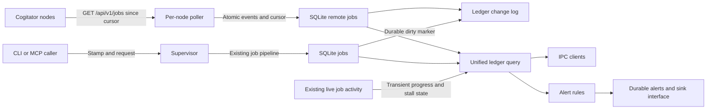

# Job ledger

The service keeps a metadata ledger in its existing `state.db`. Augur jobs use the existing `jobs` rows, with a `ledger` metadata column. Remote work uses `ledger_remote`. The service combines both when it answers a ledger query. The CLI and MCP server stamp submissions. The existing Jobs views still use their existing job calls.



## Record

`packages/dispatch-protocol/src/job-ledger.ts` exports the wire types and validation functions. `LedgerJob` wraps an Augur `JobRecord` by reference through `node`, `localId`, and `id`; it does not embed a request or result.

| Field | Meaning |
| --- | --- |
| `id`, `node`, `localId` | The global id is `<node>:<localId>`. Each component has 1 to 128 ASCII letters, digits, dots, underscores, or hyphens. |
| `kind` | `augur-job`, `media-job`, `llm-request`, `model-load`, `model-evict`, `install`, or `download`. |
| `state` | `queued`, `running`, `stalled`, `done`, `failed`, `canceled`, or `node-lost`. |
| `stamp`, `attribution` | Caller metadata and its source, described below. |
| `summary`, `summarySource` | One ASCII line of at most 120 characters, supplied by the `caller`, written by a `local-model`, or empty with source `none`. |
| `route`, `model`, `activity` | The route, served or configured model, and activity. A route or model can be null. |
| `createdAt`, `startedAt`, `endedAt`, `updatedAt`, `lastActivityAt` | Milliseconds since the Unix epoch. Start, end, and last activity can be null. The local `updatedAt` records the latest execution-state timestamp. |
| `durationMs` | The end minus the start, or creation when the job never started. It is null while the job is active. Clients calculate elapsed time from their current time and `startedAt ?? createdAt`. |
| `activityLine` | A transient live progress line, at most 120 ASCII characters. The ledger does not persist it. |
| `parentId`, `retryOf`, `retriedAs` | Qualified ledger ids, or null. |
| `usage` | Provider-reported token counts and cost, or null. The existing accounting call supplies Augur's derived and imputed figures separately. |
| `exitReason` | A metadata exit reason, or null. Local jobs use their execution state here rather than harness error text. |
| `compacted` | Whether the detail retention window has expired. |

The service maps local `completed` to `done`, `cancelled` to `canceled`, and terminal failures, including a lost runner, to `failed`. Approval and queue states appear as `queued`; cancellation in flight appears as `running`. A live stall overlays the running state. A failed local runner has a known end time. An unreachable remote node has an unknown outcome and appears as `node-lost` until the node answers again.

## Stamp

`Stamp` accepts these optional fields. A job request carries `stamp`, and a caller can also carry `caller.stamp`. An IPC request can carry a connection-level `stamp`; request fields override connection fields. Stamps are claims about attribution and grant no permission.

| Field | HTTP header |
| --- | --- |
| `sessionId` | `X-Augur-Session` |
| `sessionTitle` | `X-Augur-Session-Title` |
| `origin` | `X-Augur-Origin` |
| `originLabel` | `X-Augur-Origin-Label` |
| `pid` | `X-Augur-Pid` |
| `parentPid` | `X-Augur-Parent-Pid` |
| `host` | `X-Augur-Host` |
| `summary` | `X-Augur-Summary` |

Header values use UTF-8 percent encoding through `encodeURIComponent`; receivers decode once. Header names ignore case. The exported `stampHeaders` and `stampFromHeaders` functions share this mapping. Text fields have at most 256 characters and no control characters. Process ids are positive safe integers. Summaries also satisfy the shorter ASCII rule. Unknown stamp fields are rejected.

`origin` is `claude-code`, `cli`, `mcp`, `hermes`, `scheduled-task`, `service`, or `other`. The `session`, `origin`, `process`, and `host` attribution groups each record `stamped`, `inferred`, or `unknown`. A partial claim stamps its group; inference fills only groups with no claim. A session title is caller metadata and is never guessed from task text.

`augur run` accepts `--session`, `--session-title`, `--origin`, and `--summary`. Flags override `AUGUR_SESSION`, `AUGUR_SESSION_TITLE`, `AUGUR_ORIGIN`, and `AUGUR_SUMMARY`. The same connection stamp accompanies related CLI calls. The CLI adds its process ids and host name. MCP uses origin `mcp` and label `augur-mcp`, passes the four environment fields, and uses the host session for pick matching. A nested Augur job receives its parent's session id and title through those environment names. It does not inherit the parent's summary.

For an unstamped Windows pipe caller, `jobhost.exe --peer-pid` reads the peer process id from the inherited server pipe handle. `--process-info` reads its executable name and parent id from the process snapshot. A process-tree walk recognizes supported origin names, stops after six processes, and detects loops. Linux reads process names and parent ids from `/proc/<pid>/stat`; macOS uses `ps` with `ppid` and `comm`. A transport that supplies Unix peer credentials can use the same walk. When the runtime supplies no Unix peer pid, or a process cannot be read, the missing groups remain `unknown`. HTTP dispatch uses the socket peer address and user agent as inferred metadata. It does not trust forwarding headers for attribution.

## Local summaries

`JobSummarizer.summarize(prompt, signal)` is the small service interface. `fillJobSummary` runs after submission without awaiting it, stops waiting after 750 ms, aborts the request, and leaves source `none` on timeout or failure. A late reply cannot replace a caller summary or patch a compacted record.

The default implementation calls the `summarize` role at `http://127.0.0.1:8470/v1/chat/completions`. It accepts only numeric loopback addresses, refuses redirects, and sends Cogitator's `X-Cogitator-Via` guard so the role cannot forward the prompt to a peer. It sends at most the first 8000 prompt characters. Its own request carries a fixed summary to prevent recursive summary work. When the usage engine is running, the call uses the existing Cogitator manage credential. A missing key, unavailable model, or unavailable local gateway leaves the summary empty.

## Node events

The service pulls `GET /api/v1/jobs?since=<cursor>` independently from each configured node every five seconds, at service startup, and through `ledger_refresh`. Pulling keeps a sleeping node independent of the service's uptime and does not make a central gateway a dependency for other nodes. Each request has a three-second timeout and refuses redirects. A refresh consumes up to ten pages per node; later refreshes continue from the committed cursor. Concurrent refreshes share the same in-flight poll.

The service's `config.json` accepts a `ledgerNodes` array. Each entry has a durable `node` id, a `url`, and an optional `keyName` reference to an existing secret-store entry. Without `keyName`, a running usage engine supplies `cogitator.manageKey`. URLs follow the existing key transport rule: HTTPS, or HTTP on the home network or loopback. Entries contain no key values. Each node must be registered directly so its collection does not depend on another node being up. The service reads this registry at startup.

```json
{
  "version": 1,
  "node": "node-uuid",
  "events": [],
  "next": "0",
  "more": false
}
```

Each event is `{ "seq": "1", "at": 1790000000000, "job": <LedgerJob> }`. `seq` and `next` are unsigned 64-bit decimal strings, with no leading zeros except `0`. A node persists its identity and sequence counter across restarts. Each new local id is unique for that node's lifetime. A reinstall that loses this state uses a new node id. The endpoint returns only its own work, including calls from other programs, and never re-exports another node's events. Remote pages cannot introduce `augur-job` records.

Events after `since` are contiguous and strictly increasing. An event carries the whole current metadata record, including its original creation time and unchanged kind. `next` is the last sequence returned, or exactly `since` for an empty page. `more` is true only when another page is ready. A node retains unconsumed events; this contract has no truncation or cursor-reset response. Clock time does not order events. Authentication uses a manage-scoped credential on Cogitator's receiving endpoint.

The receiver validates every record and the entire envelope before writing. It commits the remote projections, change-log rows, and node cursor in one SQLite transaction. Replayed events do not add duplicate rows. An invalid transition rolls back the whole page. A terminal state cannot change into another state, and running work cannot return to queued. Retries use new ids and chain links.

The service persists `unreachableSince`, `lastSeenAt`, and the last cursor for every polled node. It overlays `node-lost` on that node's active jobs after a failed poll and leaves finished jobs unchanged. A successful page clears the overlay, including an empty page with no new events. Collection resumes at the persisted cursor after a restart or outage.

## Query API

The shared `Methods` interface in `packages/dispatch-protocol/src/ipc.ts` types these calls. Owner and agent tokens can read them. The HTTP dispatch bridge also serves the nonstreaming calls.

| Method | Parameters | Result |
| --- | --- | --- |
| `ledger_list` | `LedgerQuery`, or no parameters | `{ jobs, next }` |
| `ledger_get` | `{ id }`, using the qualified ledger id | `{ job, parent, children, retries }`, or null |
| `ledger_counts` | `LedgerQuery`, or no parameters | Counts for every ledger state, including zero counts |
| `ledger_changes` | `{ since?, limit? }` | `{ changes, cursor, more }` |
| `ledger_watch` | `{ since? }` | Initial `{ cursor }`, then newline-delimited `{ event: "ledger_change", change }` messages on the same connection |
| `ledger_nodes` | None | Node cursor and reachability records |
| `ledger_refresh` | None | Node records after a poll |
| `ledger_alerts` | None | Persisted alert events |

`LedgerQuery` filters by `session` id, `origin`, `node`, `state` array, `kind` array, exact `route`, inclusive creation-time `from` and `to`, and case-insensitive substring `text`. Text searches ids, summaries, session titles, origin labels, routes, models, and activities. A session filter means jobs started with that caller session id. It is separate from a model conversation name.

Sorting uses `createdAt`, `startedAt`, `endedAt`, or `durationMs`, with `order` set to `asc` or `desc`. The default is creation time descending. Null values sort as -1. The qualified id breaks ties. `limit` defaults to 100 and accepts 1 through 1000. A client passes `next` as `page` to continue with the same filters and ordering. The opaque keyset cursor binds to that query. Concurrent state changes can move records when sorting by mutable fields, so a client uses the watch for current state.

Changes use a service-local durable sequence, independent of node cursors. A watch replays after `since`, then sends changes as they arrive. The exported `watchLedger` client handles this connection. A slow reader exceeding the socket buffer limit is disconnected and can reconnect with its last processed cursor. Activity text stays transient and is available from list and get; durable change events carry state and activity timestamps.

## Retention and privacy

The existing database uses WAL mode and full synchronous commits. Triggers put local job ids into a durable dirty queue inside the job writer's transaction. A ledger read or service refresh drains that queue into the append-only change log. A restart drains any remaining markers, so a crash between a job update and its projection does not lose the job.

`policy.balance.ledger.retentionDays` defaults to 90 and accepts whole days from 0 through 3650. It is documented in `BALANCE_FIELDS` and the classic balance fixture. The service checks compaction at startup and hourly. The existing `retentionDays` service setting still controls execution-folder cleanup separately.

Each old finished job becomes a summary row that keeps its id, node, origin, session id and title, route, model, activity, summary, creation, start, end, duration, state, reported usage, and exit reason. Session ids and chain links remain for historical queries. Process details, host attribution, activity timestamps, and detailed change history are removed. Local execution metadata and events are cleared in the same transaction. Active jobs remain detailed. A transaction replaces each job's detail with its summary, and interruption rolls back that job without deleting its row. Rerunning skips completed compactions. SQLite can retain freed pages and WAL history until it reuses or checkpoints them; compaction is logical retention, not secure erasure.

The ledger accepts a fixed metadata schema and rejects request, prompt, answer, key, and unknown fields. It never copies environment values apart from the four stamp names. The existing execution subsystem can keep results and opted-in prompts in job folders under its existing settings. That subsystem is separate from ledger persistence. Caller-supplied summaries and titles are metadata supplied by the caller; the ledger does not inspect their meaning. Live activity can derive from execution output, so the ledger strips that line before writing SQLite events or remote projections.

## Alert events

`LedgerAlert` is a versioned JSON object with `version`, stable `id`, `type`, `at`, `jobId`, `node`, `state`, `route`, nullable `sessionId`, `summary`, `elapsedMs`, nullable `usualMs`, and `samples`. Types are `job.stalled`, `job.failed`, and `job.over-usual-time`. An id combines the qualified job id and the alert type. The service persists each type at most once per job, including across restarts.

The duration rule uses completed jobs from the same node, kind, and route. It waits for at least eight samples, takes their median duration, and flags a running job when its elapsed time exceeds both three times that median and one minute. Stalled and failed jobs have their own rules. A node outage alone does not produce a failure alert.

`AlertSink.emit(LedgerAlert)` is the delivery interface. The shipped sink does nothing; `MemoryAlertSink` records events for tests. A sink exception does not stop jobs. `ledger_alerts` supplies the persisted events to a later delivery process. Desktop and global alert delivery are separate consumers of this contract.
